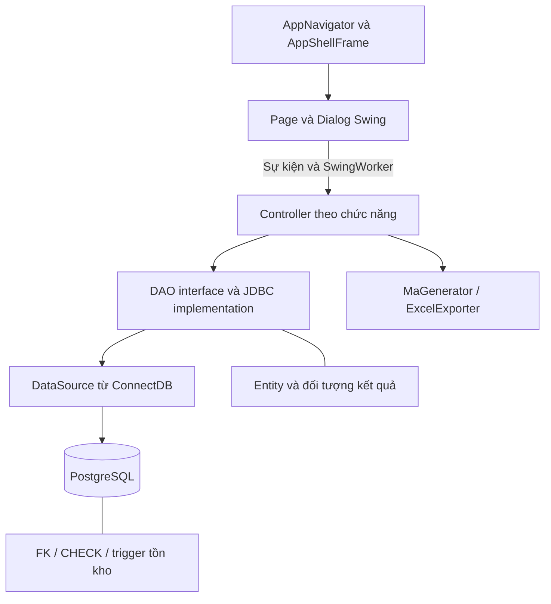

# Kịch bản trình bày demo — Phần Tài

Ngày soạn: 06/11/2026 · Mốc code đối chiếu: `ea45f69` trên `develop`.

**File SQL chạy từng phần:** [demo-check.sql](demo-check.sql). Mở bằng Query Tool/SQL Editor kết nối DB demo, bôi đen trọn một phần có comment ID rồi Execute Selection. Có sẵn 25 phần độc lập, đầy đủ CTE và literal theo kịch bản; không cần chạy phần trước để tạo biến/view. Đọc `CHAY LUC` và `CAN THAY` ở đầu từng phần. Script chỉ SELECT, không thực hiện thay thao tác UI.

Phạm vi: UC010, UC011, UC012, UC014, UC017; lộ trình W0–W4 theo `docs/reference/plans/guide-tai.md`. Các thay đổi tích hợp/UI chung sau merge là đóng góp của nhóm, không nhận toàn bộ là code riêng của Tài.

**Trạng thái tài liệu:** Kịch bản để tập và chuẩn bị demo, đã đối chiếu các điểm UI/code nêu dưới. Chưa chạy UI–DB–Excel trong lượt soạn; dữ liệu và kết quả kỳ vọng phải được điền sau rehearsal. Đây là đầu ra trình bày được người dùng yêu cầu xuất riêng, không đánh dấu các cổng kiểm thử trong `plan.md` đã đạt. DOCX/Figma chưa được kiểm chứng lại trong lượt này.

## 0. Kịch bản chạy từng bước — đọc và thao tác theo phần này

Phần này là bản cầm tay khi đứng trình bày. Các mục 1–13 phía sau là tài liệu chuẩn bị, giải thích code và hỏi đáp. Cột **Nói** là câu có thể đọc trực tiếp; cột **Chờ/quan sát** là điểm phải dừng để người xem thấy kết quả.

### 0.1. Chốt dữ liệu trước giờ trình bày

Tài khoản dưới đây là **tài khoản demo công khai trong README và seed V2**, không phải thông tin tài khoản thật được trích từ cấu hình máy:

| Dùng ở cảnh | Ô Tài khoản | Ô Mật khẩu | Vai trò/menu cần thấy |
|---|---|---|---|
| A–C | `NVBH2026001` | `12345678` | Bán hàng; có Quản lý danh mục sản phẩm và Quản lý sản phẩm lỗi |
| D–G | `NVQL2026001` | `12345678` | Quản lý; có Quản lý khuyến mãi, Báo cáo tồn kho lâu ngày, Thống kê doanh thu |

Phải thử đăng nhập trước buổi demo: seed không chứng minh mật khẩu hiện vẫn nguyên, tài khoản chưa bị khóa hoặc DB hiện đã nạp seed. Nếu không đăng nhập được, dùng tài khoản demo đã được xác nhận; không reset mật khẩu hoặc đoán tài khoản lúc trình bày.

**Bộ giá trị cụ thể cho lần tập ngày 06/11/2026:**

| Nội dung | Giá trị nhập / chọn |
|---|---|
| Danh mục tạo rồi xóa | `DEMO Tài 0611 - Phụ kiện thử nghiệm` |
| Mô tả danh mục | `Danh mục phục vụ trình bày, chưa gắn dòng sản phẩm` |
| Danh mục thử chặn xóa | `Tivi`, mã seed `DM-2026-000001` |
| Máy thử ghi lỗi | `SAM-TV-0071` — seed V4 đặt sẵn `SAN_SANG_BAN` |
| Mô tả lỗi | `Màn hình chớp tắt khi bật nguồn - DEMO Tài 0611` |
| Ngày phát hiện | `2026-11-06` |
| Ghi chú gửi bảo hành | `Đã bàn giao máy cho bộ phận bảo hành - DEMO Tài 0611` |
| Dòng khuyến mãi | `Tủ lạnh Mitsubishi 380L`, mã `DSP-2026-000101` từ seed V13 |
| Khuyến mãi chính | `DEMO Tài 0611 - Giảm 10 phần trăm`, tỷ lệ `10` |
| Ngày KM chính | `2026-11-06` đến `2026-11-13` |
| KM thử trùng kỳ | `DEMO Tài 0611 - Kiểm tra chồng lấn`, tỷ lệ `5`, ngày `2026-11-07` đến `2026-11-09` |
| Ngưỡng báo cáo tồn | `60` |
| Kỳ doanh thu có seed V13 | `01/06/2026` đến `30/09/2026` |
| Kỳ thử không phát sinh | `01/01/2000` đến `31/01/2000` — phải SELECT xác nhận trước |
| File xuất | `Tai_UC014_0611.xlsx` và `Tai_UC017_0611.xlsx` trong thư mục đã chuẩn bị |

**Chốt trước khi bước lên trình bày:** dùng SELECT mục 10 xác nhận danh mục mới chưa tồn tại, `Tivi` còn dòng tham chiếu, serial còn bán được/chưa có hồ sơ lỗi đang xử lý, dòng KM tồn tại và không có chương trình bật giao khoảng trên. Đây là giá trị từ seed/đề xuất, chưa kiểm DB hiện tại. Nếu dữ liệu đã bị dùng, thay đúng giá trị ở bảng này và đọc xuyên suốt theo giá trị mới. Không xóa hồ sơ thật hoặc ép trạng thái máy để chạy lại demo. Nếu trình bày ngày khác, đổi ngày phát hiện và khoảng KM theo ngày thực, kiểm lại hiệu lực.

### A. Đăng nhập nhân viên bán hàng và giới thiệu phạm vi

| Bước | Tay thao tác | Chờ/quan sát | Nói |
|---|---|---|---|
| A1 | Mở ứng dụng DTAQ đã build từ mốc chốt, để cửa sổ ở kích thước đã tập | Thấy trang **Đăng nhập DTAQ**, hai ô **Tài khoản**, **Mật khẩu** | “Em bắt đầu bằng tài khoản nhân viên bán hàng, vì chức năng danh mục hiện được đặt ở vai trò này.” |
| A2 | Click ô **Tài khoản**, nhập `NVBH2026001` | Đọc lại đúng tài khoản, không dùng mã `NVBANHANG-...` để đăng nhập | Không cần đọc mật khẩu thành tiếng |
| A3 | Click **Mật khẩu**, nhập `12345678`; click **Đăng nhập** | Chờ màn **Trang chủ** của bán hàng; nếu lỗi thì dừng theo phương án dự phòng | “Tài khoản đăng nhập khác mã định danh nhân viên. Đây là tài khoản demo đã seed sẵn.” |
| A4 | Chỉ menu bên trái; nếu đang thu thành icon, bấm nút mở menu trên Topbar | Nhìn thấy tên menu **Quản lý danh mục sản phẩm**, **Quản lý sản phẩm lỗi** | “Phần em phụ trách có năm chức năng. Hai chức năng đầu liên quan dữ liệu phân loại và tình trạng từng máy; sau đó em đổi sang quản lý để trình bày khuyến mãi và báo cáo.” |

### B. Danh mục — thêm, lỗi nghiệp vụ và xóa thành công

| Bước | Tay thao tác | Chờ/quan sát | Nói |
|---|---|---|---|
| B1 | Click menu trái **Quản lý danh mục sản phẩm** | Tiêu đề trang đúng; chỉ ô tìm kiếm, nút **Thêm danh mục**, bảng và thao tác **Sửa/Xóa** | “Trang này quản lý nhóm của các dòng sản phẩm. Mỗi danh mục có mã, tên và mô tả.” |
| B2 | Click **Thêm danh mục** | Dialog **Thêm danh mục sản phẩm** xuất hiện | “Mã được ứng dụng sinh khi lưu; người dùng nhập thông tin nghiệp vụ.” |
| B3 | Ô **Tên danh mục** nhập `DEMO Tài 0611 - Phụ kiện thử nghiệm`; ô **Mô tả** nhập giá trị ở bảng chuẩn bị | Không tự nhập mã; kiểm lại tên để tránh nhầm fixture | “Danh mục này chưa gắn dòng sản phẩm, lát nữa em dùng nó để chứng minh trường hợp xóa được.” |
| B4 | Click **Lưu danh mục** | Chờ thông báo thành công; nếu dialog chưa đóng thì chỉ đóng sau khi đã thấy thành công | “Lưu thành công mới cấp mã và hiển thị kết quả.” |
| B5 | Click **Làm mới**; ở ô **Tìm danh mục** nhập `DEMO Tài 0611`; click **Tìm kiếm** | Dòng vừa tạo hiện ra; ghi mã thực vào giấy demo | “Em tải lại để xác nhận dữ liệu được lưu, không chỉ thêm tạm trên giao diện.” |
| B6 | Click **Thêm danh mục**, nhập lại đúng tên vừa lưu và mô tả bất kỳ; click **Lưu danh mục** | Dừng cho người xem đọc lỗi trùng tên; click **Hủy** để đóng | “Tên trùng bị chặn. Đây là lỗi đầu vào hợp lệ về định dạng nhưng vi phạm tính duy nhất.” |
| B7 | Xóa từ khóa cũ, nhập `Tivi`, click **Tìm kiếm**; tại dòng mã `DM-2026-000001` bấm **Xóa** | Dialog **Xác nhận xóa danh mục** xuất hiện | “Tiếp theo là trường hợp có nút xóa nhưng chưa đủ điều kiện nghiệp vụ để xóa.” |
| B8 | Trong dialog bấm **Xóa danh mục** | Chờ thông báo danh mục đang có dòng sản phẩm tham chiếu; dòng `Tivi` vẫn còn | “Danh mục đang được dùng thì controller từ chối; khóa ngoại ở DB cũng bảo vệ quan hệ này. Tồn kho bằng không vẫn không làm mất tham chiếu dòng sản phẩm.” |
| B9 | Tìm lại `DEMO Tài 0611`; bấm **Xóa** đúng dòng vừa tạo → **Xóa danh mục** | Thấy thông báo xóa thành công; bấm **Làm mới**, tìm lại để thấy không còn dòng | “Trường hợp xóa được là danh mục chưa có dòng sản phẩm tham chiếu, ví dụ danh mục vừa tạo nhầm này.” |
| B10 | Chuyển sang cửa sổ SQL đã mở sẵn; chạy SELECT danh mục theo mã thực vừa xóa, rồi quay lại app | Kết quả 0 dòng; SELECT `Tivi` vẫn tồn tại | “Đây là đối chiếu dữ liệu sau hai kết quả khác nhau: một bị chặn, một xóa được.” |

#### SELECT kiểm tra ngay dưới cảnh B

Mở Query Tool của DB demo đang dùng cùng ứng dụng, dán và chạy từng khối. Không mở transaction dài trong cửa sổ kiểm tra vì có thể đọc snapshot cũ. Các câu dưới chỉ đọc dữ liệu, chưa được chạy trên DB live trong lượt soạn.

**B-SQL1 — chạy trước B2, sau B4 và sau lần lưu trùng B6:**

```sql
SELECT "maDanhMuc", "tenDanhMuc", "moTa"
FROM "DanhMucSanPham"
WHERE lower(btrim("tenDanhMuc")) =
      lower(btrim('DEMO Tài 0611 - Phụ kiện thử nghiệm'));
```

Expected: trước tạo **0 dòng**; sau lưu **1 dòng**; sau thử trùng vẫn **1 dòng**. Ghi mã được trả về, không đoán mã sinh tiếp theo.

**B-SQL2 — trước và sau thử xóa Tivi ở B8:**

```sql
SELECT dm."maDanhMuc", dm."tenDanhMuc",
       COUNT(dsp."maDongSP") AS "soDongDangThamChieu"
FROM "DanhMucSanPham" dm
LEFT JOIN "DongSanPham" dsp ON dsp."maDanhMuc" = dm."maDanhMuc"
WHERE dm."maDanhMuc" = 'DM-2026-000001'
GROUP BY dm."maDanhMuc", dm."tenDanhMuc";
```

Expected: một dòng Tivi, số tham chiếu **>0** trước và sau; thử xóa bị chặn. Không yêu cầu số máy tồn phải >0.

**B-SQL3 — sau xóa thành công B9:** chạy lại B-SQL1, expected **0 dòng**. Để chứng minh bằng mã thay vì tên, thay literal dưới bằng mã đã ghi từ B-SQL1:

```sql
SELECT "maDanhMuc", "tenDanhMuc"
FROM "DanhMucSanPham"
WHERE "maDanhMuc" = '<MA_THUC_DA_GHI_O_B_SQL1>';
```

Expected 0 dòng theo đúng mã vừa xóa. Không chạy nguyên placeholder rồi coi kết quả 0 dòng là bằng chứng.

### C. Máy lỗi — ghi nhận một serial và gửi bảo hành

| Bước | Tay thao tác | Chờ/quan sát | Nói |
|---|---|---|---|
| C1 | Click menu **Quản lý sản phẩm lỗi** | Chỉ tiêu đề, ô tìm kiếm, danh sách hồ sơ, nút **Ghi nhận máy lỗi**, cột **Xử lý** | “Đơn vị quản lý ở đây là từng máy theo serial, không chỉ là tên dòng sản phẩm.” |
| C2 | Chỉ cửa sổ SQL đã có kết quả trước thao tác cho `SAM-TV-0071` và counter dòng của nó | Máy đang `SAN_SANG_BAN`, chưa có hồ sơ đang xử lý; ghi counter trước | “Em chọn máy đang bán được để thấy rõ việc ghi lỗi tác động đến trạng thái và lượng bán được.” |
| C3 | Quay lại app → **Ghi nhận máy lỗi** | Dialog ghi nhận mở ra | “Mỗi hồ sơ lưu serial, mô tả, ngày phát hiện và nguồn chứng từ nếu có.” |
| C4 | Nhập **Số Serial máy** `SAM-TV-0071`; **Mô tả lỗi** theo bảng; **Ngày phát hiện** `2026-11-06`; ghi chú `Ghi nhận lỗi nội bộ - DEMO Tài 0611`; để trống **Mã chứng từ đổi/trả** | Đọc lại serial và ngày | “Đây là lỗi phát hiện nội bộ nên không nhập mã phiếu đổi trả.” |
| C5 | Click **Ghi nhận lỗi**; sau thành công tìm serial trong trang, click **Tìm kiếm** | Hồ sơ có mã mới và tình trạng chờ xử lý | “Hồ sơ mới ở trạng thái chờ xử lý. Máy sẵn sàng bán chuyển sang hàng lỗi.” |
| C6 | Chạy SELECT mục 10 cho serial và counter | Hồ sơ `CHO_XU_LY`, máy `HANG_LOI`, counter bán được giảm 1 so với trước | “Hai cập nhật dùng chung transaction. Em đối chiếu DB để không chỉ dựa vào dòng hiển thị.” |
| C7 | Quay lại trang → **Ghi nhận máy lỗi**, nhập lại cùng serial và mô tả/ngày hợp lệ → **Ghi nhận lỗi** | Dừng đọc lỗi đã có hồ sơ đang xử lý; bấm **Hủy** | “Hệ thống chặn tạo thêm hồ sơ đang xử lý cho cùng máy.” |
| C8 | Tìm lại hồ sơ vừa tạo → tại cột thao tác click **Xử lý** | Dialog **Chuyển trạng thái xử lý lỗi** | “Khi bàn giao bảo hành, em cập nhật cả tình trạng xử lý hồ sơ và trạng thái máy.” |
| C9 | Dropdown **Trạng thái xử lý mới** chọn **Đã gửi bảo hành**; **Ghi chú xử lý mới** nhập ghi chú ở bảng; click **Cập nhật trạng thái** | Chờ thành công; đọc dòng hồ sơ và SELECT lại | “Hồ sơ thành đã gửi bảo hành, máy thành đang bảo hành. Máy vẫn không thuộc lượng sẵn sàng bán.” |

#### SELECT kiểm tra ngay dưới cảnh C

**C-SQL1 — trước C3, sau C5 và sau C9:**

```sql
SELECT s."soSerial", s."maDongSP", s."trangThai" AS "trangThaiMay",
       l."maLoi", l."tinhTrangXuLy", l."moTaLoi",
       l."ngayGhiNhan", l."ghiChuXuLy",
       l."maPhieuTra", l."maPhieuDoi"
FROM "SanPham" s
LEFT JOIN "SanPhamLoi" l ON l."soSerial" = s."soSerial"
WHERE s."soSerial" = 'SAM-TV-0071'
ORDER BY l."ngayGhiNhan", l."maLoi";
```

Expected theo fixture demo: trước tạo, máy `SAN_SANG_BAN` và chưa có hồ sơ lỗi đang xử lý. Sau tạo, hồ sơ mới `CHO_XU_LY`, máy `HANG_LOI`. Sau C9, hồ sơ `DA_GUI_BAO_HANH`, máy `DANG_BAO_HANH`. Chứng từ nguồn để trống trong cảnh lỗi nội bộ này. Nếu đã có lịch sử, đối chiếu đúng mã hồ sơ mới, không đếm nhầm toàn bộ lịch sử.

**C-SQL2 — trước C3, sau C5, sau C7 và sau C9:**

```sql
SELECT d."maDongSP", d."tenDongSP", d."soLuongTon",
       COUNT(s."soSerial") FILTER
         (WHERE s."trangThai" = 'SAN_SANG_BAN') AS "demMayBanDuoc",
       d."soLuongTon" = COUNT(s."soSerial") FILTER
         (WHERE s."trangThai" = 'SAN_SANG_BAN') AS "counterKhop"
FROM "DongSanPham" d
LEFT JOIN "SanPham" s ON s."maDongSP" = d."maDongSP"
WHERE d."maDongSP" =
      (SELECT "maDongSP" FROM "SanPham" WHERE "soSerial" = 'SAM-TV-0071')
GROUP BY d."maDongSP", d."tenDongSP", d."soLuongTon";

SELECT COUNT(*) AS "soHoSoCuaSerial"
FROM "SanPhamLoi" WHERE "soSerial" = 'SAM-TV-0071';
```

Ghi counter và số hồ sơ trước thao tác. Sau C5: counter giảm **1**, `counterKhop=true`, số hồ sơ tăng **1**. Sau thử ghi trùng C7: cả hai giữ nguyên. Sau gửi bảo hành C9: counter giữ nguyên vì `HANG_LOI` và `DANG_BAO_HANH` đều không bán được. So sánh khi không có thao tác đồng thời của người khác trên cùng dòng.

### D. Đổi sang tài khoản quản lý

| Bước | Tay thao tác | Chờ/quan sát | Nói |
|---|---|---|---|
| D1 | Click tên/tài khoản người dùng ở Topbar → **Đăng xuất** | Hộp xác nhận hiện ra | “Các cảnh tiếp theo thuộc vai trò quản lý, nên em đổi phiên đăng nhập.” |
| D2 | Xác nhận **Đăng xuất** | Trở về màn đăng nhập | Không bấm **Đổi mật khẩu** |
| D3 | Ô **Tài khoản** nhập `NVQL2026001`; ô **Mật khẩu** nhập `12345678`; click **Đăng nhập** | Chờ trang chủ quản lý; mở rộng sidebar nếu cần | “Vai trò quản lý có khuyến mãi và báo cáo. Việc đổi phiên cũng cho thấy menu được tổ chức theo vai trò.” |

### E. Khuyến mãi — tạo chương trình và thử xung đột

| Bước | Tay thao tác | Chờ/quan sát | Nói |
|---|---|---|---|
| E1 | Click **Quản lý khuyến mãi** | Chỉ bảng chương trình, bộ lọc dòng/trạng thái, **Thêm khuyến mãi**, **Bật / Dừng áp dụng** | “Trang này quản lý chương trình giảm giá theo dòng sản phẩm và khoảng thời gian.” |
| E2 | Click **Thêm khuyến mãi** | Dialog mở, kiểm đủ ô tên/tỷ lệ/ngày/dòng | “Em tạo chương trình giảm 10% để giải thích điều kiện áp dụng.” |
| E3 | Nhập tên chính ở bảng; mô tả `Khuyến mãi phục vụ demo`; tỷ lệ `10`; ngày bắt đầu `2026-11-06`; ngày kết thúc `2026-11-13` | Ngày ở dialog này dùng `YYYY-MM-DD` | “Tỷ lệ là phần trăm; ngày bắt đầu không được sau ngày kết thúc.” |
| E4 | Dropdown **Dòng sản phẩm áp dụng** chọn `Tủ lạnh Mitsubishi 380L (DSP-2026-000101)`; tick **Bật áp dụng ngay sau khi lưu** → **Lưu khuyến mãi** | Chờ thành công, nhớ tên/mã chương trình | “Chương trình gắn với dòng này. Cờ bật và điều kiện ngày cùng quyết định hiệu lực.” |
| E5 | Click **Làm mới**, lọc đúng dòng vừa chọn | Thấy chương trình vừa tạo; kiểm ngày và tỷ lệ | “Em tải lại và lọc theo dòng để quan sát dữ liệu đã lưu.” |
| E6 | **Thêm khuyến mãi**; nhập tên thử chồng lấn, tỷ lệ `5`, ngày `2026-11-07`–`2026-11-09`; chọn cùng dòng; tick bật → **Lưu khuyến mãi** | Dừng đọc lỗi chồng lấn rồi **Hủy** | “Hai chương trình cùng bật, cùng dòng và giao nhau về thời gian thì bị từ chối.” |
| E7 | Click chọn đúng hàng chương trình 10%; bấm **Bật / Dừng áp dụng** | Không có bước xác nhận trong code hiện tại; chờ thông báo và bảng tải lại | “Nút này đổi cờ áp dụng trực tiếp. Dừng chương trình không được làm thay đổi số tiền lịch sử trên hóa đơn.” |
| E8 | Đối chiếu SELECT chương trình theo mã/dòng; trở lại app | Cờ đổi, không xuất hiện chương trình thử chồng lấn | “Phần tích hợp hóa đơn chỉ trình bày thêm khi đã chạy kiểm chứng riêng, em không suy từ màn quản lý khuyến mãi.” |

#### SELECT kiểm tra ngay dưới cảnh E

**E-SQL1 — preflight trước E2 và chạy lại sau E4/E6/E7:**

```sql
SELECT d."maDongSP", d."tenDongSP", k."maKM", k."tenKM",
       k."tyLeGiam", k."ngayBatDau", k."ngayKetThuc", k."dangApDung",
       (k."dangApDung" AND CURRENT_DATE BETWEEN k."ngayBatDau"
          AND k."ngayKetThuc") AS "hieuLucHomNay"
FROM "DongSanPham" d
LEFT JOIN "KhuyenMai" k ON k."maDongSP" = d."maDongSP"
WHERE d."maDongSP" = 'DSP-2026-000101'
ORDER BY k."ngayBatDau", k."maKM";
```

Nếu tên cột KM trên schema đã đổi, phải cập nhật theo schema trước demo; các tên ở đây đối chiếu code/schema mốc soạn. Expected sau E4: tên KM chính, tỷ lệ 10, ngày 06–13/11/2026, `dangApDung=true`. Sau E7: chương trình chính chuyển `false`. `hieuLucHomNay` còn phụ thuộc ngày DB, không mặc định luôn true.

**E-SQL2 — tìm chương trình bật giao với khoảng demo trước khi tạo:**

```sql
SELECT "maKM", "tenKM", "ngayBatDau", "ngayKetThuc"
FROM "KhuyenMai"
WHERE "maDongSP" = 'DSP-2026-000101'
  AND "dangApDung" = true
  AND "ngayBatDau" <= DATE '2026-11-13'
  AND "ngayKetThuc" >= DATE '2026-11-06';
```

Expected preflight **0 dòng**; sau E4 có chương trình chính. Nếu trước E4 đã có chương trình giao nhau, chọn fixture khác trước buổi demo, không dừng chương trình của người khác.

**E-SQL3 — sau E6, xác nhận lần lưu bị từ chối không tạo bản ghi:**

```sql
SELECT "maKM", "tenKM", "dangApDung"
FROM "KhuyenMai"
WHERE "maDongSP" = 'DSP-2026-000101'
  AND "tenKM" = 'DEMO Tài 0611 - Kiểm tra chồng lấn';
```

Expected **0 dòng**, với điều kiện tên thử chưa tồn tại trước lần chạy. Nếu đổi tên/fixture trong bảng chuẩn bị, đổi cùng literal ở cả UI và SQL.

### F. Tồn lâu — lọc, drill-down và xuất file

| Bước | Tay thao tác | Chờ/quan sát | Nói |
|---|---|---|---|
| F1 | Click **Báo cáo tồn kho lâu ngày** | Tiêu đề trang và ba KPI; tìm ô ngưỡng `60` | “Trang này giúp quản lý tìm từng máy nằm kho vượt ngưỡng ngày.” |
| F2 | Xóa từ khóa tìm nếu có, chọn ngành hàng tất cả; nhập ngưỡng `60`; bỏ tick **Chỉ tính máy sẵn sàng bán** → **Xem báo cáo** | Chờ bảng/KPI tải xong, không đọc số lúc loading | “Chế độ này gồm sẵn sàng bán, hàng lỗi và đang bảo hành; không tính máy đã rời kho.” |
| F3 | Trỏ lần lượt **Tổng số máy tồn lâu**, **Dòng sản phẩm ảnh hưởng**, **Số ngày tồn lâu nhất** | Đọc số thực trên màn, không đọc số dự đoán | “Ba KPI lần lượt cho biết bao nhiêu máy, bao nhiêu dòng và máy tồn lâu nhất bao nhiêu ngày.” |
| F4 | Tick **Chỉ tính máy sẵn sàng bán** → **Xem báo cáo** | So tập dữ liệu/KPI với F2 | “Lúc này chỉ còn máy bán được. Máy em vừa gửi bảo hành không nằm trong tập này.” |
| F5 | Bỏ tick → **Xem báo cáo**; double-click hàng thuộc dòng máy muốn xem | Chỉ các máy cùng dòng theo drill-down; đọc mã/serial trong bảng | “Em thu hẹp từ báo cáo tổng sang các máy của một dòng để xử lý cụ thể.” |
| F6 | Bấm **Xuất báo cáo**; trong hộp lưu chọn thư mục demo, nhập `Tai_UC014_0611.xlsx`, bấm nút lưu của hộp hệ điều hành | Chờ thông báo xuất thành công | “File phải theo đúng danh sách đang hiển thị sau lọc, không phải toàn bộ dữ liệu ban đầu.” |
| F7 | Mở file vừa lưu bằng Excel; chỉ vài serial và số hàng tương ứng bảng app | Không tuyên bố khớp nếu chưa đếm/so | “Em đối chiếu số hàng và serial giữa Excel với màn hình.” |

#### SELECT kiểm tra ngay dưới cảnh F

**F-SQL1 — danh sách chi tiết đúng bộ lọc và KPI, chạy sau mỗi lần đổi lọc hoặc drill-down:**

Sửa duy nhất CTE `p` cho khớp màn hình: `chi_san_sang=false` ở F2; `true` ở F4; `ma_dong=NULL` khi chưa drill-down, hoặc mã dòng đã double-click ở F5. `tu_khoa` và `nganh_hang` phải giống nội dung filter UI. `NULL` ở ngành hàng tương ứng “Tất cả”.

```sql
WITH p AS (
  SELECT 60::int AS nguong_ngay, false AS chi_san_sang,
         NULL::text AS ma_dong, ''::text AS tu_khoa,
         NULL::text AS nganh_hang
), tap AS (
  SELECT s."soSerial", d."maDongSP", d."tenDongSP", dm."tenDanhMuc",
         s."ngayNhapKhoBanDau", s."trangThai",
         CURRENT_DATE - s."ngayNhapKhoBanDau" AS "soNgayTon"
  FROM "SanPham" s
  JOIN "DongSanPham" d ON d."maDongSP" = s."maDongSP"
  JOIN "DanhMucSanPham" dm ON dm."maDanhMuc" = d."maDanhMuc"
  CROSS JOIN p
  WHERE s."trangThai" IN ('SAN_SANG_BAN','HANG_LOI','DANG_BAO_HANH')
    AND (NOT p.chi_san_sang OR s."trangThai" = 'SAN_SANG_BAN')
    AND CURRENT_DATE - s."ngayNhapKhoBanDau" >= p.nguong_ngay
    AND (p.ma_dong IS NULL OR d."maDongSP" = p.ma_dong)
    AND (p.nganh_hang IS NULL OR dm."tenDanhMuc" = p.nganh_hang)
    AND (p.tu_khoa = ''
      OR strpos(lower(d."maDongSP"), lower(btrim(p.tu_khoa))) > 0
      OR strpos(lower(d."tenDongSP"), lower(btrim(p.tu_khoa))) > 0
      OR strpos(lower(s."soSerial"), lower(btrim(p.tu_khoa))) > 0)
)
SELECT * FROM tap
ORDER BY "tenDongSP", "ngayNhapKhoBanDau", "soSerial";
```

Đối chiếu **từng serial**, trạng thái và số ngày với bảng UI/file F6–F7. Để lấy ba KPI, giữ nguyên cả CTE phía trên và **thay SELECT cuối** bằng:

```sql
SELECT COUNT(*) AS "tongMayTonLau",
       COUNT(DISTINCT "maDongSP") AS "soDongBiAnhHuong",
       COALESCE(MAX("soNgayTon"), 0) AS "tonLauNhat"
FROM tap;
```

Đoạn SELECT KPI phải chạy **cùng CTE**, không chạy riêng vì `tap` chỉ tồn tại trong một câu SQL. Kết quả lần lượt khớp ba KPI trên màn. Máy `SAM-TV-0071` chỉ xuất hiện nếu đủ ngưỡng và không bị filter khác loại; ở F4 phải bị loại do đang bảo hành. Không cộng số hàng của hai lần lọc với nhau.

### G. Doanh thu — chọn kỳ, đọc số và xuất Excel

| Bước | Tay thao tác | Chờ/quan sát | Nói |
|---|---|---|---|
| G1 | Quay lại app, click **Thống kê doanh thu** | Chờ tải; chỉ bốn KPI, biểu đồ cột, top dòng sản phẩm và **Xuất Excel** | “Báo cáo này nhìn giao dịch đã thanh toán và các điều chỉnh trả hàng theo kỳ.” |
| G2 | Bấm nút có ngày/kỳ trên đầu trang (lúc chưa có nhãn là **Chọn kỳ báo cáo**) | Dialog **Chọn kỳ báo cáo**, ô **Từ ngày**, **Đến ngày** | “Em chọn kỳ có dữ liệu seed để kết quả dễ quan sát.” |
| G3 | Trong ô ngày chọn phần văn bản, nhập Từ ngày `01/06/2026`, Đến ngày `30/09/2026`; rời ô bằng Tab để chốt giá trị spinner; kiểm lại ngày → **Áp dụng** | Chờ loading kết thúc và nhãn kỳ cập nhật | “Màn doanh thu hiện dùng hộp chọn kỳ này, ngày hiển thị dạng ngày/tháng/năm.” |
| G4 | Trỏ **Tổng doanh thu trong kỳ**, **Tổng tiền hàng trước thuế**, **Tổng tiền thuế phát sinh**, **Hóa đơn bán lẻ thành công** | Đọc giá trị thật của từng KPI; chỉ chú thích số phiếu đổi/trả dưới KPI HĐ | “Doanh thu bằng tiền hàng sau điều chỉnh cộng thuế. Số hóa đơn đếm chứng từ, không phải số chi tiết sản phẩm.” |
| G5 | Click **Ngày**, rồi **Tuần**, rồi **Tháng**, mỗi lần chờ tải xong | Trục thời gian thay đổi; tổng KPI cùng kỳ không đổi | “Đổi cách gộp giúp quan sát xu hướng, không đổi tổng tiền của kỳ.” |
| G6 | Trỏ biểu đồ top dòng và chú giải tên/màu | Đọc một tên dòng thực tế | “Biểu đồ lấy tối đa năm dòng có giá trị dương; dòng âm hoặc bằng không không có lát tỷ trọng.” |
| G7 | **Xuất Excel** → chọn thư mục demo → `Tai_UC017_0611.xlsx` → lưu; chờ thành công rồi mở Excel | Chỉ cột ngày/dòng/tiền hàng/thuế/tổng; so với bảng đối chiếu đã chuẩn bị | “File lấy kết quả của kỳ đang xem. Số tiền cộng từ snapshot đã lưu, không lấy giá hiện tại để tính lại.” |
| G8 | Trở lại app → mở kỳ → nhập `01/01/2000` đến `31/01/2000` → Tab → **Áp dụng** | Nếu preflight xác nhận rỗng: thấy không phát sinh, không còn KPI của kỳ trước, xuất bị vô hiệu khi không có dòng | “Đây là trường hợp không có giao dịch, hệ thống phải thể hiện rỗng thay vì giữ số liệu kỳ trước.” |
| G9 | Mở lại kỳ, trả về `01/06/2026`–`30/09/2026` → **Áp dụng** | Chờ dữ liệu cũ tải lại để kết thúc ở màn có nội dung | “Tiếp theo em mở một đoạn code giải thích cách hệ thống bảo vệ luồng dữ liệu.” |

#### SELECT kiểm tra ngay dưới cảnh G

Các câu sau dùng kỳ G3: **01/06/2026–30/09/2026**, tính cả hai đầu. Giữ nguyên khoảng ngày khi so số; nếu UI đổi kỳ, đổi CTE `p` tương ứng. Đây là các truy vấn kiểm tra trực tiếp trên bảng và phép cộng snapshot, không gọi lại controller.

**G-SQL1 — bốn KPI và số phiếu đổi/trả:** chạy sau G3 và mỗi lần nhóm Ngày/Tuần/Tháng ở G5. Kết quả phải không đổi khi chỉ đổi nhóm thời gian.

```sql
WITH p AS (
  SELECT DATE '2026-06-01' AS tu, DATE '2026-09-30' AS den
), hd AS (
  SELECT h."maHD"
  FROM "HoaDon" h CROSS JOIN p
  WHERE h."trangThaiThanhToan" = true
    AND h."ngayLap" BETWEEN p.tu AND p.den
), ban AS (
  SELECT COALESCE(SUM(c."tienSauKhuyenMai"),0) AS hang,
         COALESCE(SUM(c."tienThue"),0) AS thue
  FROM hd JOIN "ChiTietHoaDon" c ON c."maHD" = hd."maHD"
), tra AS (
  SELECT t."maPhieuTra", c."tienSauKhuyenMai", c."tienThue"
  FROM "PhieuTra" t
  JOIN "ChiTietPhieuTra" x ON x."maPhieuTra" = t."maPhieuTra"
  JOIN "ChiTietHoaDon" c ON c."maHD" = x."maHD"
                           AND c."soSerial" = x."soSerial"
  CROSS JOIN p
  WHERE t."trangThaiXuLyPhieu" = 'HOAN_TAT'
    AND t."trangThaiDuyet" IN ('KHONG_CAN_DUYET','DA_DUYET')
    AND t."ngayHoanTat" BETWEEN p.tu AND p.den
), doi AS (
  SELECT DISTINCT d."maPhieuDoi"
  FROM "PhieuDoi" d
  JOIN "ChiTietPhieuDoi" x ON x."maPhieuDoi" = d."maPhieuDoi"
  JOIN "ChiTietHoaDon" c ON c."maHD" = x."maHD"
                           AND c."soSerial" = x."soSerial"
  CROSS JOIN p
  WHERE d."trangThaiXuLyPhieu" = 'HOAN_TAT'
    AND d."trangThaiDuyet" IN ('KHONG_CAN_DUYET','DA_DUYET')
    AND d."ngayHoanTat" BETWEEN p.tu AND p.den
), tien_tra AS (
  SELECT COALESCE(SUM("tienSauKhuyenMai"),0) AS hang,
         COALESCE(SUM("tienThue"),0) AS thue FROM tra
)
SELECT ban.hang - tien_tra.hang AS "tienHangTruocThue",
       ban.thue - tien_tra.thue AS "tienThue",
       ban.hang + ban.thue - tien_tra.hang - tien_tra.thue AS "tongDoanhThu",
       (SELECT COUNT(*) FROM hd) AS "soHoaDonThanhCong",
       (SELECT COUNT(DISTINCT "maPhieuTra") FROM tra)
         + (SELECT COUNT(*) FROM doi) AS "soPhieuDoiTra"
FROM ban CROSS JOIN tien_tra;
```

So `tongDoanhThu`, `tienHangTruocThue`, `tienThue`, `soHoaDonThanhCong` với bốn card G4; `soPhieuDoiTra` với chú thích dưới card số HĐ. Không lấy tổng `tienHoan` ở phiếu để thay phép cộng snapshot trước thuế/thuế; phép đối soát này theo cách ghi nhận đang có trong UC017. Đổi hàng không cộng/trừ tiền theo D17.

**G-SQL2 — chi tiết nguồn và tiền từng dòng để so file Excel, biểu đồ:**

```sql
WITH p AS (
  SELECT DATE '2026-06-01' AS tu, DATE '2026-09-30' AS den
), tap AS (
  SELECT h."ngayLap" AS ngay, c."maDongSP",
         'BAN'::text AS nguon, NULL::text AS ma_phieu,
         SUM(c."tienSauKhuyenMai") AS hang, SUM(c."tienThue") AS thue
  FROM "HoaDon" h
  JOIN "ChiTietHoaDon" c ON c."maHD" = h."maHD"
  CROSS JOIN p
  WHERE h."trangThaiThanhToan" = true AND h."ngayLap" BETWEEN p.tu AND p.den
  GROUP BY h."ngayLap", c."maDongSP"
  UNION ALL
  SELECT t."ngayHoanTat", c."maDongSP", 'TRA', t."maPhieuTra",
         -c."tienSauKhuyenMai", -c."tienThue"
  FROM "PhieuTra" t
  JOIN "ChiTietPhieuTra" x ON x."maPhieuTra" = t."maPhieuTra"
  JOIN "ChiTietHoaDon" c ON c."maHD" = x."maHD" AND c."soSerial" = x."soSerial"
  CROSS JOIN p
  WHERE t."trangThaiXuLyPhieu" = 'HOAN_TAT'
    AND t."trangThaiDuyet" IN ('KHONG_CAN_DUYET','DA_DUYET')
    AND t."ngayHoanTat" BETWEEN p.tu AND p.den
  UNION ALL
  SELECT d."ngayHoanTat", c."maDongSP", 'DOI', d."maPhieuDoi", 0, 0
  FROM "PhieuDoi" d
  JOIN "ChiTietPhieuDoi" x ON x."maPhieuDoi" = d."maPhieuDoi"
  JOIN "ChiTietHoaDon" c ON c."maHD" = x."maHD" AND c."soSerial" = x."soSerial"
  CROSS JOIN p
  WHERE d."trangThaiXuLyPhieu" = 'HOAN_TAT'
    AND d."trangThaiDuyet" IN ('KHONG_CAN_DUYET','DA_DUYET')
    AND d."ngayHoanTat" BETWEEN p.tu AND p.den
)
SELECT ngay, "maDongSP", hang AS "tienHang", thue AS "tienThue",
       hang + thue AS "tongThanhToan", nguon, ma_phieu
FROM tap ORDER BY ngay, "maDongSP", nguon, ma_phieu;
```

Năm cột đầu tương ứng các cột file Excel; hai cột cuối giúp chỉ nguồn giao dịch khi giải thích. Thứ tự hàng có thể khác file; so theo giá trị/nhóm và số lần xuất hiện, không loại bỏ các dòng trùng giá trị. Bán đã group theo ngày/dòng; trả và đổi giữ từng dòng chi tiết như nguồn hiện tại.

**G-SQL3 — biểu đồ Ngày/Tuần/Tháng:** giữ nguyên CTE `p, tap` của G-SQL2, thay SELECT cuối bằng đoạn dưới. Đổi literal `'day'` thành `'week'` hoặc `'month'` theo lựa chọn G5. CTE lịch thêm các kỳ có số tiền 0 giống biểu đồ UI.

```sql
SELECT date_trunc('day', lich.ngay)::date AS "mocKy",
       SUM(COALESCE(t.tien,0)) AS "doanhThuVND",
       SUM(COALESCE(t.tien,0)) / 1000000.0 AS "doanhThuTrieuVND"
FROM p
CROSS JOIN LATERAL generate_series(p.tu::timestamp, p.den::timestamp,
                                  INTERVAL '1 day') AS lich(ngay)
LEFT JOIN (SELECT ngay, SUM(hang + thue) AS tien FROM tap GROUP BY ngay) t
  ON t.ngay = lich.ngay::date
GROUP BY date_trunc('day', lich.ngay)::date
ORDER BY "mocKy";
```

Đổi **cả hai** vị trí `'day'` trong `date_trunc`; giữ `INTERVAL '1 day'`. Tuần bắt đầu thứ Hai; mốc tuần có thể trước ngày đầu kỳ nhưng chỉ cộng giao dịch trong kỳ. UI biểu đồ chuyển đơn vị triệu VND, KPI vẫn là VND.

**G-SQL4 — top 5 dòng:** giữ CTE G-SQL2, thay SELECT cuối bằng:

```sql
SELECT t."maDongSP", d."tenDongSP", SUM(t.hang + t.thue) AS "giaTriDuongVND"
FROM tap t JOIN "DongSanPham" d ON d."maDongSP" = t."maDongSP"
GROUP BY t."maDongSP", d."tenDongSP"
HAVING SUM(t.hang + t.thue) > 0
ORDER BY "giaTriDuongVND" DESC
LIMIT 5;
```

So tên và giá trị với top 5; nếu có đồng hạng ở vị trí thứ 5, không khẳng định thứ tự ổn định vì code hiện chưa quy định tie-break riêng. Tỷ trọng donut phải xét trên tập lát được hiển thị, không mặc định mẫu số là toàn bộ doanh thu.

**G-SQL5 — preflight và kiểm kỳ rỗng G8:** chạy lại G-SQL1 **và** G-SQL2 với CTE `p` đổi thành:

```sql
SELECT DATE '2000-01-01' AS tu, DATE '2000-01-31' AS den
```

Expected: G-SQL1 ba số tiền/số HĐ/số phiếu đều 0; G-SQL2 **0 dòng**. Chỉ tổng tiền bằng 0 chưa chứng minh không phát sinh, vì bán và trả có thể bù nhau hoặc phiếu đổi có tiền 0. Không chạy riêng đoạn đổi ngày rồi coi là đã kiểm dữ liệu.

### H. Mở code và kết thúc

| Bước | Tay thao tác | Nói |
|---|---|---|
| H1 | Chuyển IDE, mở `SanPhamLoiController.ghiNhanLoi`; trỏ lần lượt kiểm serial, kiểm hồ sơ trùng, `setAutoCommit(false)`, insert, đổi trạng thái, `commit` và `rollback` | “Đây là luồng em vừa thao tác: dữ liệu UI thành tham số Java; controller kiểm tra, tạo hồ sơ và đổi trạng thái trên cùng connection. Khi lỗi, rollback giữ tính nguyên tử.” |
| H2 | Mở `ThongKeDoanhThuDaoImpl`, trỏ điều kiện HĐ đã thanh toán và điều kiện phiếu trả hoàn tất/duyệt | “Doanh thu dùng snapshot chi tiết hóa đơn. Phiếu trả điều chỉnh ở kỳ hoàn tất; theo D17, đổi hàng không tạo khoản thu hoặc hoàn.” |
| H3 | Quay về app ở màn doanh thu | “Em đã đi từ danh mục, trạng thái máy, khuyến mãi tới báo cáo. Phần cốt lõi là dữ liệu nhất quán và kết quả giải thích được bằng quy tắc và code. Em xin nhận câu hỏi.” |

**Quy tắc khi tập:** sau mỗi thao tác ghi phải chờ thông báo trước bước kế tiếp. Khi kết quả lệch, dừng tại bước đó, ghi actual và dùng phần dự phòng mục 12; không đọc câu “thành công/khớp DB” khi màn hình và SELECT chưa chứng minh. Không đọc toàn bộ phần giải thích kỹ thuật ở các mục sau trong lúc đang click; dùng chúng để trả lời khi được hỏi.

## 1. Chuẩn bị trước buổi trình bày

- Dùng DB demo đã xác nhận; kiểm migration và tác vụ backup/health/recovery trước khi mở app. Không chạy restore hoặc thử gây lỗi DB trong buổi trình bày.
- Chạy bản build từ đúng commit đã chốt. Nếu commit thay đổi, rà lại thao tác và số liệu trong tài liệu.
- Chuẩn bị hai tài khoản: **nhân viên bán hàng** để demo UC010 (menu danh mục hiện chỉ ở vai trò này), và **quản lý** để demo UC012/UC014/UC017. UC011 có ở cả hai menu. Không đưa mật khẩu lên slide/log. Đổi phiên: menu tài khoản tại Topbar → **Đăng xuất**. Bắt đầu bằng phiên bán hàng cho UC010/UC011, chuyển sang quản lý trước UC012.
- Mở sẵn IDE ở các class của mục 9 và một cửa sổ truy vấn chỉ đọc. Không sửa code/SQL nghiệp vụ ngay khi trình bày.
- Chuẩn bị hai file Excel đầu ra khác tên cho UC014 và UC017. Kiểm tra thư mục ghi được và không ghi đè tài liệu quan trọng.
- Chạy thử các cảnh bên dưới; chỉ đưa cảnh đã xác minh vào demo chính thức. Lưu ảnh/SQL/Excel của run thử để dự phòng, ghi rõ ngày và commit.

Điền bảng này bằng dữ liệu thực trước khi tập. Các ký hiệu trong ngoặc là chỗ cần thay, không phải mã có sẵn trong hệ thống.

| Ký hiệu | Dữ liệu cần chuẩn bị | Giá trị đã kiểm tra |
|---|---|---|
| D | Ngày thực hiện demo | … |
| DM-MOI | Tên danh mục mới, ví dụ `DEMO-TAI-<ngày>-Gia dụng` | … |
| DM-CO-SP | Danh mục đang có dòng sản phẩm để thử chặn xóa | … |
| SERIAL-LOI | Máy demo đang `SAN_SANG_BAN`, chưa có hồ sơ lỗi đang xử lý | … |
| DONG-KM | Dòng sản phẩm riêng, chưa có KM bật giao khoảng D..D+7 | … |
| KY | Từ ngày/đến ngày có hóa đơn đã thanh toán và dữ liệu trả phù hợp | … |
| KY-RONG | Kỳ đã SELECT xác nhận không phát sinh | … |
| EXCEL-TON / EXCEL-DT | Đường dẫn hai file kết quả | … |

Ghi trước: counter của dòng chứa SERIAL-LOI; số hồ sơ lỗi của serial; danh sách serial tồn ≥60 ngày; ba tổng tiền và số hóa đơn của KY. Nếu cảnh ghi lỗi làm thay đổi báo cáo tồn, tính expected UC014 theo **trạng thái sau cảnh UC011**.

## 2. Nhịp trình bày — khoảng 20 phút

| Phút | Cảnh | Thông điệp cần chứng minh |
|---|---|---|
| 0–2 | Phạm vi và kiến trúc | Hiểu đường đi từ UI tới DB và ranh giới phần Tài |
| 2–4 | UC010: danh mục | Dữ liệu tham chiếu phải được bảo vệ |
| 4–7 | UC011: máy lỗi | Một serial, hai trạng thái liên quan, một transaction |
| 7–10 | UC012: khuyến mãi | Hiệu lực theo dòng và thời gian; chống chồng lấn |
| 10–13 | UC014: tồn lâu | Tồn vật lý khác số máy đang bán được |
| 13–17 | UC017: doanh thu | Tiền từ snapshot, trả hàng điều chỉnh đúng kỳ |
| 17–20 | Mở code và trả lời câu hỏi | Giải thích giải pháp, lỗi và giới hạn thực tế |

## 3. Mở đầu và sơ đồ kiến trúc

**Lời nói mẫu:**

> “Phần em phụ trách gồm danh mục sản phẩm, sản phẩm lỗi, khuyến mãi, báo cáo tồn lâu và thống kê doanh thu. Em trình bày mỗi chức năng theo ba điểm: người dùng giải quyết việc gì, dữ liệu thay đổi thế nào và code xử lý ở đâu. Bán hàng, đổi trả và hạ tầng dùng chung là điểm tích hợp với các thành viên khác.”



> “UI nhận thao tác và hiển thị kết quả; controller điều phối validation, quyền và nghiệp vụ theo chức năng; DAO truy vấn, ánh xạ dữ liệu. DB giữ ràng buộc và trigger tồn kho. Các tác vụ tải báo cáo chạy nền để giao diện không bị chặn.”

**Lưu ý khi giải thích kiến trúc hiện có:** Sơ đồ là luồng chính, chưa thể hiện mọi phụ thuộc. `SanPhamLoiController` có helper SQL cập nhật máy ngay trên connection transaction; `ThongKeDoanhThuController` đang phụ thuộc kiểu biểu đồ/KPI của UI. Nếu được hỏi, chỉ rõ đây là mức tách lớp thực tế và điểm còn có thể cải thiện, không khẳng định mọi controller hoàn toàn độc lập UI hoặc mọi SQL đều ở DAO.

**Chuyển cảnh:** “Em bắt đầu từ danh mục — dữ liệu nền cho các dòng sản phẩm.”

## 4. UC010 — Danh mục sản phẩm (2 phút)

Heading đặc tả: **Thêm danh mục sản phẩm**; màn UI: **Quản lý danh mục sản phẩm**.

| Bước | Thao tác trên UI | Điều cần quan sát / lời giải thích |
|---|---|---|
| 1 | Mở màn danh mục → **Thêm danh mục** | Mã do ứng dụng cấp; không tự nhập mã demo cố định |
| 2 | Nhập DM-MOI và mô tả phân biệt dữ liệu demo; lưu bằng nút chính của dialog | Ghi lại mã thực được cấp; danh mục xuất hiện trong bảng |
| 3 | Bấm **Làm mới**, tìm tên vừa thêm | Dữ liệu đọc lại được, không chỉ là một dòng vừa thêm vào bảng UI |
| 4 | Mở thêm mới, nhập lại tên DM-MOI; thử lưu rồi đóng dialog | Nếu đúng expected đã rehearsal: từ chối trùng tên, không tạo bản ghi thứ hai |
| 5 | Tìm DM-CO-SP → **Xóa** → xác nhận | Bị chặn do đang có dòng sản phẩm tham chiếu; kiểm bản ghi vẫn tồn tại |
| 6 | Chọn DM-MOI vừa thêm, bảo đảm chưa gắn dòng sản phẩm → **Xóa** → xác nhận → **Làm mới** | Xóa thành công; SELECT theo mã đã cấp trả 0 dòng. Không dùng danh mục này làm tiền điều kiện cảnh sau |

**Lời nói mẫu:**

> “Danh mục không chỉ là nhãn hiển thị. Dòng sản phẩm đang tham chiếu danh mục thì việc xóa phải bị chặn để không làm đứt quan hệ dữ liệu. Quy tắc kiểm tra nằm ở controller, DAO kiểm tra tham chiếu; DB còn bảo vệ bằng khóa ngoại.”

**Điểm code:** `DanhMucController.themMoi`, `capNhat`, `xoa`; `DanhMucSanPhamDaoImpl`; `CategoriesPage` và `CategoryDialog`. Tên trùng được kiểm tra theo cách chuẩn hóa đang có trong code, không tự khẳng định tìm trùng không dấu.

**DB:** SELECT theo mã thực vừa cấp; xác nhận đúng một bản ghi DM-MOI. SELECT dòng sản phẩm theo `maDanhMuc` của DM-CO-SP trước và sau thử xóa.

**Phân biệt quyền và điều kiện xóa:** Navigation hiện cấp màn này cho nhân viên bán hàng; `DanhMucController.xoa` kiểm điều kiện chưa có dòng sản phẩm tham chiếu nhưng **chưa kiểm session/role**. DAO thực hiện DELETE, báo lỗi nếu mã không tồn tại; FK `ON DELETE RESTRICT` chặn xóa khi có tham chiếu. Vì vậy không nói controller đã cưỡng chế đầy đủ quyền xóa. UC010 dẫn xuất đặc tả luồng thêm với tác nhân bán hàng; chưa có cơ sở từ đoạn này để khẳng định nguồn đặc tả chi tiết quyền xóa riêng.

**Chuyển cảnh:** “Từ dữ liệu phân loại, em chuyển sang quản lý từng máy vật lý theo serial.”

## 5. UC011 — Ghi nhận và xử lý máy lỗi (3 phút)

Heading đặc tả: **Thêm sản phẩm lỗi**; màn UI: **Quản lý sản phẩm lỗi**.

| Bước | Thao tác trên UI | Kết quả phải kiểm trước buổi demo |
|---|---|---|
| 1 | Tìm SERIAL-LOI, đối chiếu trạng thái/counter ban đầu trong DB | Máy sẵn sàng bán, không có hồ sơ đang xử lý |
| 2 | **Ghi nhận máy lỗi**; nhập serial, mô tả `Lỗi màn hình — dữ liệu demo`, ngày D theo `YYYY-MM-DD` | Để trống chứng từ khi demo lỗi nội bộ; không bịa mã phiếu đổi/trả |
| 3 | Lưu bằng nút chính của dialog rồi **Làm mới** | Hồ sơ mới `CHO_XU_LY`; máy từ `SAN_SANG_BAN` thành `HANG_LOI` |
| 4 | Thử ghi lại cùng serial | Bị từ chối khi hồ sơ trước còn đang xử lý; không thêm hồ sơ trùng |
| 5 | Mở thao tác chuyển trạng thái của hồ sơ vừa tạo → **Đã gửi bảo hành** → nhập ghi chú → **Cập nhật trạng thái** | Hồ sơ `DA_GUI_BAO_HANH`, máy `DANG_BAO_HANH`; kiểm lại DB |

**Lời nói mẫu:**

> “Hệ thống theo dõi từng máy bằng serial. Hồ sơ xử lý lỗi và trạng thái của máy là hai dữ liệu liên quan. Khi ghi nhận lỗi hoặc đổi trạng thái, controller dùng cùng connection và transaction: thành công thì commit, lỗi thì rollback. Với máy sẵn sàng bán này, khi thành hàng lỗi thì số máy bán được của dòng phải giảm một.”

**Điểm code:** `SanPhamLoiController.ghiNhanLoi`, `chuyenTrangThai`, `capNhatTrangThaiSanPham`; DAO overload nhận `Connection`; trigger `trg_sanpham_cap_nhat_ton` ở V6.

**Không nói quá:** Code hiện có ánh xạ trạng thái hồ sơ sang trạng thái máy; chưa có bằng chứng trong lượt này rằng mọi chuyển đổi ngược hoặc mọi tình huống cạnh tranh đều bị chặn. Không demo luân chuyển tùy ý rồi tuyên bố có state machine đầy đủ.

**Chuyển cảnh:** “Máy lỗi không bán được; với máy bán được, khuyến mãi lại phải đúng dòng và đúng thời điểm.”

## 6. UC012 — Khuyến mãi (3 phút)

Heading đặc tả: **Thêm khuyến mãi**; màn UI: **Quản lý khuyến mãi**.

| Bước | Thao tác trên UI | Điều cần chứng minh |
|---|---|---|
| 1 | **Thêm khuyến mãi**; tên `DEMO-TAI-<ngày>-10%`; chọn DONG-KM | KM gắn với một dòng sản phẩm |
| 2 | Tỷ lệ `10`; ngày D..D+7 theo `YYYY-MM-DD`; tick **Bật áp dụng ngay sau khi lưu** → **Lưu khuyến mãi** | Giá trị thực tế phải không xung đột fixture có sẵn |
| 3 | **Làm mới**, lọc dòng vừa chọn | Chương trình được đọc lại và phân loại đúng thời gian |
| 4 | Tạo chương trình khác cùng dòng, cũng bật, khoảng D+1..D+3 | Bị từ chối vì hai khoảng giao nhau; không có bản ghi mới do lần lưu thất bại |
| 5 | Đóng dialog; chọn chương trình đã tạo → **Bật / Dừng áp dụng** | Code hiện đổi cờ trực tiếp, không có dialog xác nhận; phân biệt cờ áp dụng và trạng thái theo ngày |

**Lời nói mẫu:**

> “Cờ bật chưa đủ để kết luận khuyến mãi đang hiệu lực; còn phải nằm trong ngày bắt đầu và kết thúc. Với cùng dòng sản phẩm, code kiểm tra chồng lấn khi cả hai chương trình cùng bật. Khi bán hàng, giá trị khuyến mãi áp dụng phải được lưu snapshot trên chi tiết hóa đơn để lịch sử không đổi theo chương trình hiện tại.”

**Điểm code:** `KhuyenMaiController.themMoi`, `batDauApDung`, `dungApDung`, `timKhuyenMaiHieuLuc`; `KhuyenMaiDaoImpl.findHieuLuc`, `existsChongLan`.

**Điểm tích hợp tùy chọn:** Chỉ mở hóa đơn để chứng minh áp dụng KM/snapshot nếu đã chạy và kiểm chứng UC012→UC003. Nếu chưa, trình bày hợp đồng cung cấp cho luồng bán hàng và ghi đây là phần tích hợp chưa demo, không nói đã chứng minh bằng UI.

**Chuyển cảnh:** “Tiếp theo em dùng trạng thái và ngày nhập của từng máy để tìm hàng lưu kho lâu.”

## 7. UC014 — Báo cáo tồn kho lâu ngày (3 phút)

Nguồn có lệch tên “hằng ngày”/“lâu ngày”; phần demo này theo màn **Báo cáo tồn kho lâu ngày** hiện có.

| Bước | Thao tác trên UI | Điều cần đối chiếu |
|---|---|---|
| 1 | Mở báo cáo, ngưỡng `60`, bỏ tick **Chỉ tính máy sẵn sàng bán** → **Xem báo cáo** | Mỗi dòng dữ liệu là một máy/serial; tuổi tồn từ ngày nhập ban đầu |
| 2 | Chỉ ba KPI | Tổng máy tồn lâu, số dòng bị ảnh hưởng, số ngày tồn lớn nhất khớp tập kết quả |
| 3 | Tick **Chỉ tính máy sẵn sàng bán** → **Xem báo cáo** | Chỉ còn `SAN_SANG_BAN`; máy demo đang bảo hành không còn trong tập này |
| 4 | Bỏ tick, xem lại; tìm/lọc một dòng sản phẩm hoặc dùng drill-down đã rehearsal | Tập dữ liệu và KPI theo màn đang hiển thị được kiểm lại |
| 5 | **Xuất báo cáo** → chọn EXCEL-TON; mở Excel | So serial, số dòng và cột với tập đang lọc, không so với tập trước lọc |

**Lời nói mẫu:**

> “Còn trong kho không đồng nghĩa bán được ngay. Theo quy tắc báo cáo hiện hành, tồn lâu gồm máy sẵn sàng bán, hàng lỗi và đang bảo hành; loại máy đã bán, trả nhà cung cấp hoặc thanh lý. DAO tính tuổi tồn bằng ngày hiện tại của DB trừ ngày nhập kho ban đầu, rồi lọc lớn hơn hoặc bằng ngưỡng.”

**Điểm code:** `BaoCaoTonKhoDaoImpl.findTonLau`; `BaoCaoTonKhoController.xemBaoCao`, `xuatExcel`; `LongStockReportPage`.

**Lưu ý ngày:** `CURRENT_DATE` là ngày phiên DB; so với ngày D đã chốt khi rehearsal, nhất là nếu trình bày gần nửa đêm. Không khẳng định ngày máy và ngày DB luôn trùng nếu chưa kiểm.

**Chuyển cảnh:** “Cuối cùng, em trình bày báo cáo doanh thu từ dữ liệu giao dịch đã lưu.”

## 8. UC017 — Thống kê doanh thu (4 phút)

| Bước | Thao tác trên UI | Điều cần chứng minh |
|---|---|---|
| 1 | Mở **Thống kê doanh thu**, bấm nút kỳ báo cáo → chọn KY trong `PeriodDialog` | Chờ tải xong, không đọc KPI đang loading |
| 2 | Đọc ba KPI tiền và số hóa đơn | Tổng doanh thu = tiền hàng trước thuế + thuế sau điều chỉnh; số HĐ không đếm từ số dòng chi tiết |
| 3 | Đổi nhóm **Ngày / Tuần / Tháng** | Dữ liệu được gộp lại, tổng tiền của cùng kỳ phải giữ nguyên |
| 4 | Chỉ biểu đồ top dòng sản phẩm | Tên/màu khác nhau; top tối đa 5 dòng có giá trị dương, không đại diện mọi dòng âm/0 |
| 5 | **Xuất Excel** → EXCEL-DT; mở file | Cột Ngày, Dòng sản phẩm, Tiền hàng trước thuế, Thuế, Tổng thanh toán; cộng các dòng khớp KPI |
| 6 | Chọn KY-RONG đã xác nhận | Thông báo không phát sinh, không giữ số liệu kỳ cũ; nút xuất không bật khi không có dòng báo cáo |

**Lời nói mẫu:**

> “Báo cáo dùng tiền đã lưu trên chi tiết hóa đơn, không lấy giá hoặc thuế hiện tại để tính lại lịch sử. Hóa đơn phải đã thanh toán và nằm trong kỳ theo ngày lập. Phiếu trả hoàn tất, đã duyệt hoặc không cần duyệt, điều chỉnh theo ngày hoàn tất bằng snapshot gốc. Theo quyết định D17 đang ghi trong dự án, đổi hàng không thu thêm hoặc hoàn tiền nên không tạo điều chỉnh tiền, nhưng phiếu đổi vẫn tham gia đếm chứng từ.”

**Ví dụ để giải thích, không nhận là số liệu DB thực:**

| Thành phần | Trước thuế | Thuế | Tổng |
|---|---:|---:|---:|
| Bán đã thanh toán trong kỳ | 10.000.000 | 1.000.000 | 11.000.000 |
| Trả hoàn tất trong kỳ | −2.000.000 | −200.000 | −2.200.000 |
| Kết quả | 8.000.000 | 800.000 | 8.800.000 |

Nếu phiếu trả xuất phát từ HĐ kỳ trước, số tiền vẫn điều chỉnh ở kỳ hoàn tất trả; không tự tăng số hóa đơn bán thành công của kỳ này. Thay bảng ví dụ bằng số đã SELECT trong rehearsal nếu muốn trình bày như dữ liệu thật.

**Điểm code:** `ThongKeDoanhThuDaoImpl.doanhThu`/`dieuChinh`; `ThongKeDoanhThuController.xem`, `taoBieuDo`, `xuatExcel`; `RevenueStatisticsPage.taiBaoCao` và `hienLoiTaiBaoCao`.

**Không nhận thêm tính năng:** UC017 hiện để giá trị xu hướng kỳ trước là `null`; nâng cấp so kỳ trước/nhận xét ở UC016 của Tuấn Anh không có nghĩa UC017 đã có tính năng tương tự. Tiền cộng bằng `BigDecimal`; kiểu số phục vụ vẽ biểu đồ là bước chuyển để hiển thị, không dùng ngược lại để tính tiền lưu DB.

## 9. Phần mở code — chọn một luồng để giải thích sâu (3 phút)

Mở IDE bằng đường dẫn dưới đây tính từ project `D:/DTAQ-Retail`; dùng tên method để tìm, vì số dòng sẽ đổi khi cập nhật branch.

| Nhu cầu giải thích | File/method mở sẵn | Nội dung nói |
|---|---|---|
| Điểm nối hệ thống | `src/main/java/com/dtaq/retail/ui/AppNavigator.java` | Khởi tạo controller/DAO và đăng ký page thực |
| Validation và từ chối xóa | `src/main/java/com/dtaq/retail/controller/DanhMucController.java` → `xoa` | Kiểm đầu vào, kiểm liên kết, trả kết quả cho UI |
| Transaction đại diện | `src/main/java/com/dtaq/retail/controller/SanPhamLoiController.java` → `ghiNhanLoi` | Tra serial → chặn trùng → connection → mã → hồ sơ → trạng thái máy → commit; lỗi rollback |
| Chống chồng lấn | `src/main/java/com/dtaq/retail/dao/impl/KhuyenMaiDaoImpl.java` → `existsChongLan` | Cùng dòng, cờ áp dụng, khoảng ngày; kiểm mã khi cập nhật theo implementation |
| Báo cáo tồn | `src/main/java/com/dtaq/retail/dao/impl/BaoCaoTonKhoDaoImpl.java` → `findTonLau` | Bind checkbox/ngưỡng, tính tuổi trong SQL, map `DongTonLau` |
| Snapshot và tổng hợp | `src/main/java/com/dtaq/retail/dao/impl/ThongKeDoanhThuDaoImpl.java`; `controller/ThongKeDoanhThuController.java` | Điều kiện HĐ/phiếu, cộng tiền, distinct, dữ liệu chart/Excel |
| Bất đồng bộ | `src/main/java/com/dtaq/retail/ui/page/report/RevenueStatisticsPage.java` → `taiBaoCao` | Worker tải nền, mã yêu cầu loại kết quả cũ, cập nhật UI trong `done` |
| Counter DB | `src/main/resources/db/migration/V6__trigger_so_luong_ton.sql` | Counter đối chiếu serial bán được; không cộng/trừ tay trong demo |

**Payload mẫu để nói qua luồng UC011:**

> “UI gửi serial, mô tả lỗi, ngày, ghi chú và mã phiếu nguồn nếu có. Controller chuẩn hóa, tra máy và kiểm hồ sơ đang xử lý, rồi tạo entity `SanPhamLoi` với mã ứng dụng sinh và trạng thái `CHO_XU_LY`. DAO bind các trường vào SQL trên connection được truyền vào. Controller trả `KetQua` gồm thành công/thông báo/dữ liệu để UI phản hồi. Đây là tham số và object Java nội bộ, không có HTTP payload hay REST API trong luồng này.”

Đừng nói “đã test rollback giữa chừng” nếu mới nhìn thấy `rollback()` trong code. Dẫn run/test cụ thể khi có, hoặc nói rõ mới xác minh cấu trúc xử lý lỗi.

## 10. Các câu SELECT ngắn mở sẵn

Chạy trên DB demo bằng công cụ hiện có. Thay chuỗi trong dấu nháy bằng **mã thực đã ghi lại**; không chạy nguyên placeholder. Các truy vấn dưới là checkpoint trình bày, chưa thay thế bộ oracle E2E đầy đủ. Không dùng SELECT để sửa dữ liệu.

```sql
-- A. Danh mục vừa tạo và các dòng đang tham chiếu.
SELECT * FROM "DanhMucSanPham" WHERE "maDanhMuc" = '<MA_DM_THUC>';
SELECT "maDongSP", "maDanhMuc" FROM "DongSanPham"
WHERE "maDanhMuc" = '<MA_DM_THUC>';

-- B. Hai trạng thái sau thao tác ghi lỗi/chuyển bảo hành.
SELECT "soSerial", "maDongSP", "trangThai" FROM "SanPham"
WHERE "soSerial" = '<SERIAL_THUC>';
SELECT * FROM "SanPhamLoi" WHERE "soSerial" = '<SERIAL_THUC>';

-- C. Counter của dòng sản phẩm phải khớp số serial bán được.
SELECT d."maDongSP", d."soLuongTon",
       (SELECT COUNT(*) FROM "SanPham" s
        WHERE s."maDongSP" = d."maDongSP"
          AND s."trangThai" = 'SAN_SANG_BAN') AS "soMayBanDuoc"
FROM "DongSanPham" d WHERE d."maDongSP" = '<MA_DONG_THUC>';

-- D. Cờ và khoảng ngày của khuyến mãi.
SELECT * FROM "KhuyenMai" WHERE "maDongSP" = '<MA_DONG_THUC>';

-- E. Kiểm ngày DB trước khi so tuổi tồn.
SELECT CURRENT_DATE;
SELECT "soSerial", "trangThai", "ngayNhapKhoBanDau",
       CURRENT_DATE - "ngayNhapKhoBanDau" AS "soNgayTon"
FROM "SanPham" WHERE "maDongSP" = '<MA_DONG_THUC>'
ORDER BY "soSerial";
```

UC017: chuẩn bị trước một bảng đối soát từ `HoaDon`, `ChiTietHoaDon`, phiếu/chi tiết trả và đổi theo KY; chốt ngày lọc, trạng thái và mã chứng từ. Đếm `DISTINCT maHD` cho HĐ, không đếm số hàng sau join. Tổng snapshot bán cộng điều chỉnh trả phải khớp ba KPI. Không dùng chính `controller.xem()` làm đáp án độc lập.

## 11. Câu hỏi phản biện và câu trả lời ngắn

| Câu hỏi | Câu trả lời để nói và nơi chỉ code |
|---|---|
| Vì sao không xóa danh mục đang dùng? | Để giữ liên kết dòng sản phẩm; mở `DanhMucController.xoa` và DAO kiểm tham chiếu |
| Máy đang bảo hành có tính tồn lâu không? | Có ở chế độ tồn chung theo D10; không khi chỉ tính sẵn sàng bán. Mở `BaoCaoTonKhoDaoImpl` |
| Vì sao ghi lỗi phải transaction? | Tránh có hồ sơ lỗi nhưng máy vẫn bán được hoặc ngược lại; mở `ghiNhanLoi` |
| Bật chương trình có chắc được giảm giá? | Còn điều kiện ngày và dòng sản phẩm; mở `findHieuLuc` |
| Sau khi đổi KM thì hóa đơn cũ thế nào? | Phải giữ snapshot lúc bán; chỉ tuyên bố đã chứng minh tích hợp nếu có test/run UC003 tương ứng |
| Sao doanh thu không lấy giá hiện tại? | Giá/thuế/KM hiện tại có thể khác lúc bán; DAO cộng tiền snapshot |
| Trả của tháng trước tính vào tháng nào? | Điều chỉnh kỳ hoàn tất trả; số HĐ bán vẫn theo HĐ đã thanh toán và ngày lập |
| Mọi phiếu trên 3 triệu đều phải duyệt? | Theo D17 hiện ghi: ngưỡng áp cho tiền hoàn phiếu trả; phiếu đổi không thu/hoàn và không cần duyệt |
| Có thanh toán QR, trả góp, voucher không? | Ngoài phạm vi được duyệt; cash và KM cơ bản là phạm vi hiện tại |
| Đã bảo đảm mọi race condition chưa? | Chưa kết luận nếu chưa kiểm lock/constraint và test đồng thời; phân biệt validate trước lưu với bảo đảm ở DB |
| Kiến trúc còn điểm yếu gì? | Controller báo cáo có phụ thuộc UI và helper SQL ở controller máy lỗi; nhiều truy vấn báo cáo cần kiểm tính nhất quán khi có ghi đồng thời |
| Những test nào đã pass? | Chỉ đọc số liệu từ report gắn đúng commit/run đã thực thi; file test tồn tại không đồng nghĩa pass |

## 12. Bản rút gọn 8–10 phút và xử lý sự cố

**Bản rút gọn:** 1 phút phạm vi/sơ đồ; 1 phút UC010 chặn xóa; 2 phút UC011 ghi lỗi và đối soát trạng thái; 1 phút UC012 chặn chồng lấn; 1 phút UC014 toggle tồn bán được; 2 phút UC017 KPI/Excel; 1 phút mở transaction và giới hạn. Bỏ các thao tác tạo fixture và chuyển nhóm lặp lại, không bỏ giải thích nghiệp vụ.

| Sự cố khi trình bày | Cách xử lý |
|---|---|
| Ngày/seed không khớp, kỳ trống ngoài dự kiến | Dùng KY đã rehearsal; nếu chưa xác định được, chuyển sang bằng chứng run trước và nói rõ |
| Trùng tên danh mục hoặc KM có sẵn | Dùng marker riêng hoặc fixture dự phòng đã kiểm tra, không xóa dữ liệu người khác |
| Mất DB/tải báo cáo lỗi | Dừng thao tác ghi, không đổi cấu hình/restore tại chỗ; trình bày ảnh và log đã lưu với mốc rõ ràng |
| Xuất Excel lỗi | Giữ màn hình, nói rõ lỗi ghi file; chỉ thử đường dẫn dự phòng đã chuẩn bị, không nhận đã xuất thành công |
| Không nhớ vị trí code | Mở bảng mục 9, tìm method; giải thích đường đi dữ liệu thay vì đọc toàn bộ source |

**Lời kết mẫu:**

> “Năm chức năng em phụ trách liên kết dữ liệu phân loại, trạng thái từng máy, khuyến mãi và báo cáo. Các điểm em tập trung là bảo vệ quan hệ dữ liệu, transaction khi đổi trạng thái, giữ snapshot giao dịch và đối chiếu kết quả báo cáo với DB. Phần nào đã chạy kiểm chứng em dẫn bằng chứng cụ thể; các giới hạn còn lại em ghi riêng để nhóm tiếp tục đánh giá.”

## 13. Phiếu rehearsal trước khi dùng chính thức

| Cảnh | UI | DB/Excel | Thời gian | Evidence / việc cần sửa |
|---|---|---|---|---|
| UC010 | NOT_RUN | NOT_RUN | … | … |
| UC011 | NOT_RUN | NOT_RUN | … | … |
| UC012 | NOT_RUN | NOT_RUN | … | … |
| UC014 | NOT_RUN | NOT_RUN | … | … |
| UC017 | NOT_RUN | NOT_RUN | … | … |

Sau mỗi lần tập: điền actual, đường dẫn evidence và commit; chỉ đổi sang PASS khi đã kiểm cả UI và dữ liệu liên quan. Không ghi mật khẩu vào bảng này.
