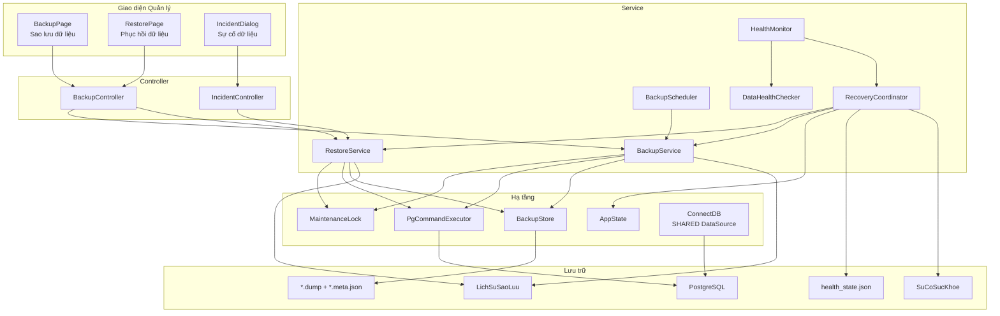
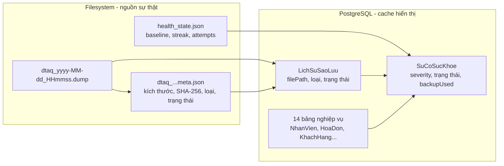
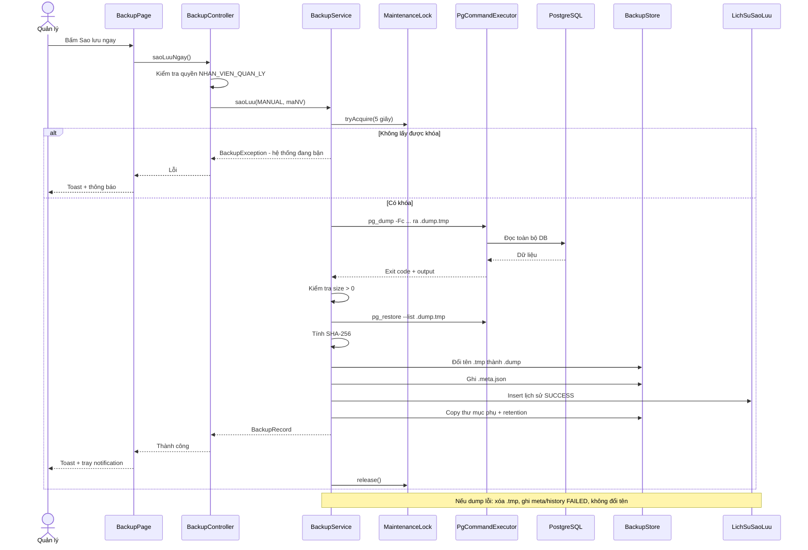
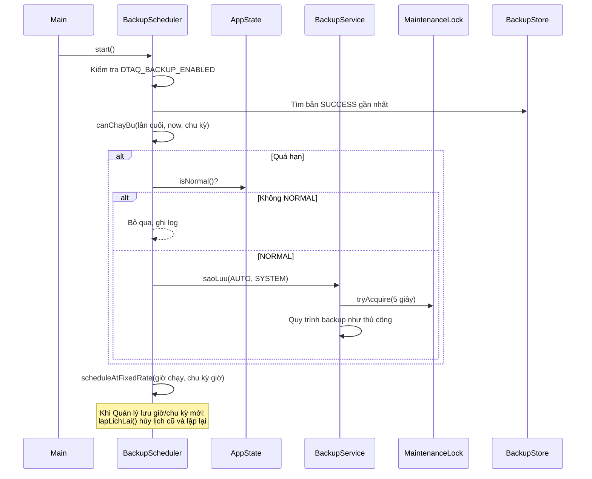
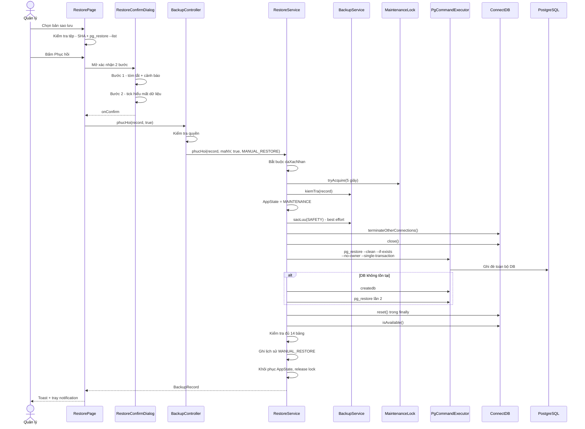
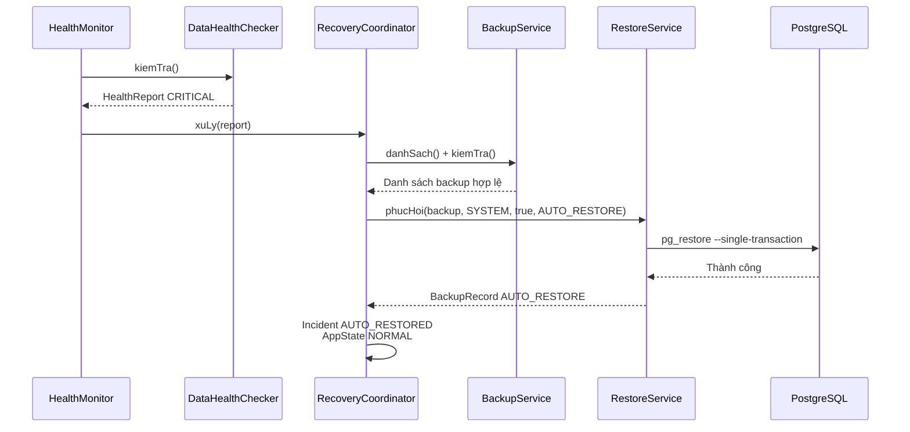
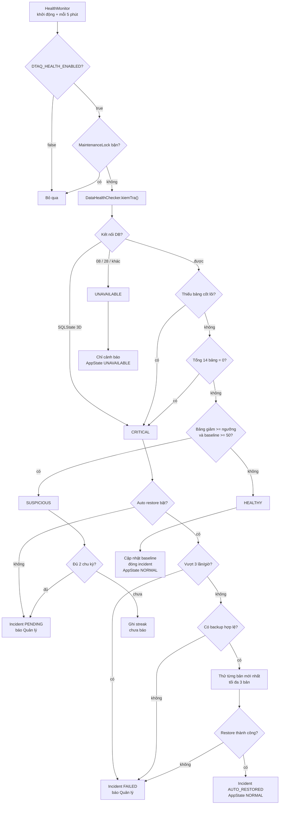
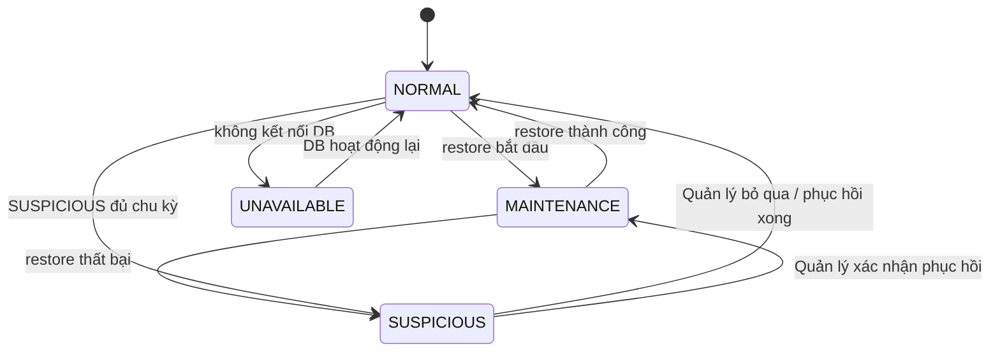

# Mô hình và quy trình Backup / Restore

**Trạng thái:** tài liệu triển khai, cập nhật 2026-11-06  
**Phạm vi:** FR015 (sao lưu), FR016 (phục hồi), HealthMonitor và cơ chế tự động phục hồi.  
**Nguồn tham chiếu:** mã nguồn trong `src/main/java/com/dtaq/retail/` và các quyết định implementation đã ghi tại [`README.md`](README.md) §5.1. Tài liệu này **không thay thế** DOCX gốc.

---

## 1. Mô hình tổng thể

### Nguyên tắc thiết kế

- **Nguồn sự thật** của một bản sao lưu là cặp tệp `*.dump` + `*.meta.json` trong thư mục backup.
- Bảng `"LichSuSaoLuu"` và `"SuCoSucKhoe"` chỉ là **cache hiển thị**; có thể dựng lại bằng cách quét tệp.
- `health_state.json` lưu baseline, streak và số lần auto restore **ngoài DB**, vì DB có thể là thứ bị mất.
- `MaintenanceLock` bảo đảm chỉ một thao tác nặng (backup, restore, health check) tại một thời điểm.
- `ConnectDB` trả về `SHARED` proxy: sau khi restore reset pool, các DAO cũ vẫn lấy được pool mới.

---

## 2. Mô hình dữ liệu

| Thành phần | Vai trò | Ghi chú |
|---|---|---|
| `*.dump` | Bản dump toàn bộ DB (`pg_dump -Fc`) | Nguồn sự thật |
| `*.meta.json` | Kích thước, SHA-256, loại, trạng thái, phiên bản PG, tên CSDL | Nguồn sự thật |
| `"LichSuSaoLuu"` | Lịch sử backup/restore để hiển thị | Cache |
| `"SuCoSucKhoe"` | Incident `SUSPICIOUS`/`CRITICAL` | Cache |
| `health_state.json` | Baseline, streak, `autoRestoreAttempts`, `openIncidentId` | Ngoài DB |

---

## 3. Backup thủ công

**Trigger:** Quản lý bấm **“Sao lưu ngay”** trên trang `Sao lưu dữ liệu`.

### Các bước cốt lõi

1. Lấy `MaintenanceLock` (timeout 5 giây).
2. `pg_dump -Fc --no-owner --no-privileges` ra file tạm `.dump.tmp`.
3. Kiểm tra exit code, kích thước > 0, `pg_restore --list` chạy được.
4. Tính SHA-256.
5. Đổi tên nguyên tử `.tmp` → `.dump`.
6. Ghi `.meta.json`.
7. Ghi lịch sử `"LichSuSaoLuu"` (best effort).
8. Copy sang thư mục phụ nếu có.
9. Retention: xóa bản cũ hơn 7 ngày, **không bao giờ xóa bản SUCCESS mới nhất**.
10. Nhả khóa.

---

## 4. Backup tự động

**Trigger:** `BackupScheduler` chạy lúc khởi động (chạy bù) và theo lịch `DTAQ_BACKUP_TIME` + chu kỳ `DTAQ_BACKUP_INTERVAL_HOURS`.

### Điều kiện và hành vi

| Điều kiện | Hành vi |
|---|---|
| `DTAQ_BACKUP_ENABLED=false` | Không tạo lịch |
| Chưa có bản SUCCESS hoặc bản gần nhất cũ hơn chu kỳ | Chạy bù ngay khi khởi động |
| `AppState != NORMAL` | Bỏ qua lần chạy, ghi log |
| Đang có lần chạy khác | Bỏ qua nhờ `AtomicBoolean dangChay` |
| Quản lý đổi giờ/chu kỳ trên UI | `lapLichLai()` hủy lịch cũ, lập lịch mới |

- Actor ghi lịch sử là `SYSTEM`, loại `AUTO`.
- Chu kỳ là **khoảng lặp thực tế**, neo theo giờ chạy: `24` = mỗi ngày, `6` = 4 lần/ngày.
- Không chạy backup tự động khi dữ liệu đang `SUSPICIOUS`, `UNAVAILABLE` hoặc đang `MAINTENANCE`.

---

## 5. Restore thủ công

**Trigger:** Quản lý chọn một bản backup trên trang `Phục hồi dữ liệu`.

### Các bước cốt lõi

1. Bắt buộc `daXacNhan = true` (đã qua 2 bước).
2. Lấy `MaintenanceLock`.
3. `BackupService.kiemTra`: file tồn tại, đúng size, đúng SHA-256, `pg_restore --list` OK.
4. Đặt `AppState = MAINTENANCE`.
5. Tạo **safety backup** hiện trạng (`SAFETY`), lỗi chỉ cảnh báo.
6. Ngắt kết nối khác, đóng pool.
7. `pg_restore --clean --if-exists --no-owner --no-privileges --single-transaction`.
8. Nếu DB không tồn tại → `createdb` → thử lại một lần.
9. `ConnectDB.reset()` mở pool mới; kiểm tra kết nối.
10. Kiểm tra đủ 14 bảng cốt lõi.
11. Ghi lịch sử `MANUAL_RESTORE` SUCCESS/FAILED.
12. Khôi phục `AppState`, nhả khóa.

> `--single-transaction` bảo đảm restore **toàn bộ hoặc không gì cả**; lỗi giữa chừng sẽ rollback.

---

## 6. Restore tự động

**Trigger:** `HealthMonitor` phát hiện `CRITICAL`.

### Điều kiện để auto restore chạy

| Điều kiện | Giá trị |
|---|---|
| `DTAQ_HEALTH_ENABLED` | `true` |
| `DTAQ_HEALTH_AUTO_RESTORE_ENABLED` | `true` |
| Trạng thái | `CRITICAL` |
| Số lần trong 1 giờ | < `DTAQ_HEALTH_AUTO_RESTORE_MAX_PER_HOUR` (3) |
| Backup hợp lệ | Có ít nhất 1 bản SUCCESS, SHA-256 + `pg_restore --list` OK |
| Khóa bảo trì | Không bận |

### CRITICAL gồm 3 trường hợp

1. Database không tồn tại — SQLState `3Dxxx`.
2. Thiếu bảng cốt lõi.
3. Tổng số dòng của **tất cả** 14 bảng cốt lõi = 0 (schema rỗng).

### Không auto restore

- `SUSPICIOUS`: dữ liệu giảm ≥ 50%, baseline ≥ 50, đủ 2 chu kỳ → incident `PENDING`, chờ Quản lý.
- `UNAVAILABLE`: server tắt / sai mật khẩu / mạng → chỉ cảnh báo.
- Auto restore bị tắt, vượt 3 lần/giờ, không có backup hợp lệ, hoặc đang bảo trì.

---

## 7. Cây quyết định của HealthMonitor

---

## 8. Máy trạng thái `AppState`

---

## 9. So sánh Manual và Automation

| Tiêu chí | Backup thủ công | Backup tự động | Restore thủ công | Restore tự động |
|---|---|---|---|---|
| Trigger | Nút “Sao lưu ngay” | Scheduler + chạy bù | Quản lý chọn bản + 2 bước | `HealthMonitor` phát hiện CRITICAL |
| Actor | `maNV` Quản lý | `SYSTEM` | `maNV` Quản lý | `SYSTEM` |
| Xác nhận | Không | Không | 2 bước + checkbox | Chính sách auto + rate limit |
| Chọn bản | Không áp dụng | Bản mới nhất theo lịch | Quản lý chọn | Bản hợp lệ mới nhất, fallback 3 bản |
| Safety backup | Không | Không | Có (`SAFETY`) | Có (`SAFETY`) |
| Loại lịch sử | `MANUAL` | `AUTO` | `MANUAL_RESTORE` | `AUTO_RESTORE` |
| UI | `ProgressDialog` + Toast | Tray/log | `ProgressDialog` + Toast | Tray + `IncidentDialog` |
| Rate limit | Không | Không | Không | 3 lần/giờ |
| Điều kiện dừng | — | `AppState != NORMAL` | — | Auto tắt / hết hạn mức / không có backup |

---

## 10. Cơ chế an toàn chung

| Cơ chế | Tác dụng |
|---|---|
| `MaintenanceLock` | Chỉ một backup/restore/health check tại một thời điểm |
| `pg_restore --single-transaction` | Restore all-or-nothing, lỗi giữa chừng rollback |
| `--clean --if-exists` | Xóa object cũ trước khi tạo lại, không lỗi nếu thiếu |
| SHA-256 + `pg_restore --list` | Không restore file hỏng/thiếu |
| Safety backup | Có thể quay lại trạng thái trước restore |
| Fallback 3 bản | Bản mới hỏng thì thử bản cũ hơn |
| Rate limit 3/giờ | Chống vòng lặp auto restore |
| `AppState` | Tạm dừng backup tự động khi dữ liệu bất thường |
| `SHARED` DataSource | DAO cũ sống lại sau khi pool được reset |
| File + `.meta.json` | Nguồn sự thật không phụ thuộc DB |
| `health_state.json` | Baseline/streak tồn tại ngoài DB |

---

## 11. Nhánh lỗi chính

| Tình huống | Xử lý |
|---|---|
| `pg_dump` lỗi / hết dung lượng | Xóa `.tmp`, ghi meta + lịch sử `FAILED`, thông báo |
| File backup hỏng / mất | `kiemTra` thất bại trước khi restore; fallback bản cũ hơn |
| `pg_restore` lỗi giữa chừng | `--single-transaction` rollback; ghi `FAILED`; thử bản kế tiếp nếu auto |
| DB không tồn tại | `createdb` rồi `pg_restore` lại một lần |
| Không có backup hợp lệ | Incident `FAILED`, cảnh báo, không ghi đè DB |
| Vượt 3 lần auto restore/giờ | Dừng auto, incident `FAILED`, yêu cầu can thiệp |
| PostgreSQL tắt / sai mật khẩu | `UNAVAILABLE`, không restore |
| Đang backup/restore khác | Bỏ qua nhờ `MaintenanceLock` |
| Quản lý bỏ qua incident | Baseline = số liệu hiện tại, incident `DISMISSED`, backup chạy lại |

---

## 12. Tham chiếu mã nguồn

| Thành phần | Tệp |
|---|---|
| Backup facade | `src/main/java/com/dtaq/retail/service/BackupService.java` |
| Restore facade | `src/main/java/com/dtaq/retail/service/RestoreService.java` |
| Lịch backup | `src/main/java/com/dtaq/retail/service/BackupScheduler.java` |
| Lưu file + metadata | `src/main/java/com/dtaq/retail/service/BackupStore.java` |
| Gọi pg_dump/pg_restore | `src/main/java/com/dtaq/retail/util/PgCommandExecutor.java` |
| Khóa bảo trì | `src/main/java/com/dtaq/retail/service/MaintenanceLock.java` |
| Health check | `src/main/java/com/dtaq/retail/service/DataHealthChecker.java` |
| Chính sách sự cố | `src/main/java/com/dtaq/retail/service/RecoveryCoordinator.java` |
| Giám sát định kỳ | `src/main/java/com/dtaq/retail/service/HealthMonitor.java` |
| Trạng thái ứng dụng | `src/main/java/com/dtaq/retail/service/AppState.java` |
| Cấu hình | `src/main/java/com/dtaq/retail/config/BackupConfig.java`, `HealthConfig.java` |
| UI sao lưu | `src/main/java/com/dtaq/retail/ui/page/backup/BackupPage.java` |
| UI phục hồi | `src/main/java/com/dtaq/retail/ui/page/backup/RestorePage.java` |
| Dialog sự cố | `src/main/java/com/dtaq/retail/ui/page/backup/IncidentDialog.java` |
| Migration | `src/main/resources/db/migration/V11__backup_history.sql`, `V12__lichsu_sao_luu_bo_rang_buoc_filepath.sql` |

---

## 13. Giới hạn đã biết

- **DB bị xóa lúc app đang tắt:** lần khởi động sau, Flyway migration chạy trước HealthMonitor và có thể dừng app trước khi auto restore kịp chạy. Auto restore cho `3D000` hiện chỉ chắc chắn khi app đang chạy.
- **`DROP TABLE` không có `CASCADE`:** PostgreSQL từ chối nếu còn khóa ngoại; cần `DROP TABLE ... CASCADE`.
- **`health_state.json` nằm trong `./backups`:** không được copy sang thư mục phụ; mất nếu xóa thư mục backup.
- **Backup chứa hash BCrypt:** không commit, không chia sẻ.
- **UI chưa có nút “Kiểm tra sức khỏe ngay”:** muốn test nhanh phải giảm `DTAQ_HEALTH_INTERVAL_MINUTES` hoặc khởi động lại app.
