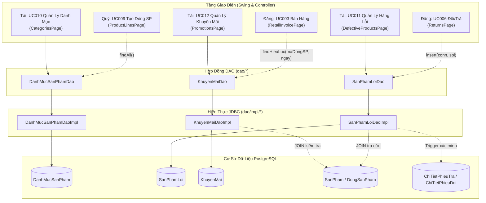

# Báo Cáo Tổng Kết & Rà Soát Wave W0 — Thành Viên: Tài

> **Người thực hiện:** Tài (`feature/tai-w0`)  
> **Phạm vi hoàn thành:** Wave W0 — Xây dựng tầng truy cập dữ liệu (DAO & DAO Impl) và kiểm thử cho 3 phân hệ: **Danh mục sản phẩm (UC010)**, **Sản phẩm lỗi (UC011 & UC006)**, **Khuyến mãi (UC012 & UC003)**.  
> **Ngày cập nhật:** 30/10/2026

---

## 1. Sơ Đồ Khối Tổng Quan Kiến Trúc Wave W0 (Tài)



---

## 2. Toàn Bộ Code Đã Hiện Thực Tại W0

Các file mã nguồn và bài kiểm thử được thêm mới thuộc phạm vi của Tài:

| Phân hệ / Thực thể | Interface DAO (`dao/`) | Lớp Hiện Thực (`dao/impl/`) | Kiểm Thử JUnit 5 (`src/test/...`) | Số Test |
|---|---|---|---|:---:|
| **Danh Mục Sản Phẩm** | `DanhMucSanPhamDao.java` | `DanhMucSanPhamDaoImpl.java` | `DanhMucSanPhamDaoImplTest.java` | 9/9 PASS |
| **Sản Phẩm Lỗi** | `SanPhamLoiDao.java` | `SanPhamLoiDaoImpl.java` | `SanPhamLoiDaoImplTest.java` | 9/9 PASS |
| **Khuyến Mãi** | `KhuyenMaiDao.java` | `KhuyenMaiDaoImpl.java` | `KhuyenMaiDaoImplTest.java` | 9/9 PASS |
| **Tổng cộng W0** | **3 Interfaces** | **3 Implementations** | **3 Test Classes** | **27/27 PASS** |

*(Ghi chú: Toàn bộ hệ thống hiện có **180/180 tests xanh 100%**, đảm bảo không gây hồi quy).*

---

## 3. Chi Tiết API Dùng Chung & Các Điểm Logic Đáng Chú Ý

### 3.1. Phân hệ Danh mục sản phẩm (`DanhMucSanPhamDao`)
> **Phục vụ:** UC010 (Tài) và cung cấp cho **Quý (UC009 - Tạo dòng sản phẩm)**.

- **Các phương thức chính:**
  - `List<DanhMucSanPham> findAll()`: Lấy toàn bộ danh mục, sắp xếp `tenDanhMuc ASC`. **Quý gọi hàm này để đổ ComboBox danh mục khi tạo Dòng sản phẩm**.
  - `Optional<DanhMucSanPham> findById(String maDanhMuc)` & `Optional<DanhMucSanPham> findByTen(String tenDanhMuc)`.
  - `void insert(DanhMucSanPham danhMuc)` & `void update(DanhMucSanPham danhMuc)`.
  - `void delete(String maDanhMuc)`: Xóa danh mục.
  - `boolean existsDongByDanhMuc(String maDanhMuc)`: Kiểm tra danh mục có dòng sản phẩm liên kết không.
  - `boolean existsByTen(String tenDanhMuc, String excludeMaDanhMuc)`: Kiểm tra trùng tên chuẩn hóa.
- **Điểm logic đáng chú ý:**
  1. **Chuẩn hóa tên danh mục (Unique Index `uq_danhmucsanpham_ten_chuan_hoa`):** Tên danh mục được kiểm tra chống trùng qua `lower(btrim(tenDanhMuc))`. Không phân biệt chữ hoa/thường và khoảng trắng đầu cuối (Ví dụ: `"  Tivi  "` và `"tivi"` coi như trùng).
  2. **Bảo vệ toàn vẹn tham chiếu (RB18, RB60):** Không được xóa danh mục khi còn dòng sản phẩm tham chiếu (`existsDongByDanhMuc = true`). Nếu xóa cưỡng bức, bắt mã lỗi PostgreSQL `23503` và ném `DataAccessException("Không thể xóa danh mục đang có dòng sản phẩm liên kết")`.

---

### 3.2. Phân hệ Sản phẩm lỗi (`SanPhamLoiDao`)
> **Phục vụ:** UC011 (Tài) và hỗ trợ **Đăng (UC006 - Nhận hàng lỗi từ Đổi/Trả)**.

- **Các phương thức chính:**
  - `void insert(Connection ketNoi, SanPhamLoi sanPhamLoi)`: **Hỗ trợ Transaction**. Đăng dùng hàm này trong cùng transaction hoàn tất phiếu đổi/trả.
  - `void insert(SanPhamLoi sanPhamLoi)`: Ghi nhận lỗi độc lập (kết nối riêng).
  - `Optional<SanPhamLoi> findDangXuLy(String soSerial)`: **Tìm hồ sơ lỗi đang ở trạng thái `CHO_XU_LY`**.
  - `Optional<SanPhamLoi> findById(String maLoi)`: Nạp đầy đủ thông tin máy lỗi (`SanPham`, `DongSanPham`, `NhaCungCap`, `PhieuTra`, `PhieuDoi`).
  - `List<SanPhamLoi> findAll()` & `List<SanPhamLoi> findByTinhTrang(TrangThaiXuLyLoi tinhTrang)`.
  - `void updateTinhTrang(Connection ketNoi, String maLoi, TrangThaiXuLyLoi tinhTrangMoi, String ghiChuXuLy, LocalDate ngayCapNhat)`: Cập nhật trạng thái kèm ngày và ghi chú.
- **Điểm logic đáng chú ý:**
  1. **Chống trùng hồ sơ lỗi (Quy tắc 9.a / UC011):** Mỗi máy chỉ được phép có **tối đa một** hồ sơ ở trạng thái `CHO_XU_LY`. Controller/UI phải kiểm tra qua `findDangXuLy(soSerial)` trước khi tạo hồ sơ mới.
  2. **Truy vết 3 nguồn gốc phát sinh:**
     - Nguồn từ trả hàng: Có `maPhieuTra`, `maPhieuDoi = null`.
     - Nguồn từ đổi hàng: Có `maPhieuDoi`, `maPhieuTra = null`.
     - Lỗi nội bộ kiểm kho: Cả `maPhieuTra` và `maPhieuDoi` đều `null`.
  3. **Trigger toàn vẹn nguồn (`fn_sanphamloi_nguon_hop_le` / RB27):** Nếu có chứng từ đổi/trả, CSDL bắt buộc số serial của máy lỗi phải nằm trong `ChiTietPhieuTra` hoặc `ChiTietPhieuDoi` của chứng từ đó. DAO bắt mã lỗi trigger `P0001` và dịch sang tiếng Việt rõ ràng.
  4. **Đồng bộ trạng thái máy (`SanPham.trangThai`):** Khi chuyển trạng thái xử lý lỗi ở `SanPhamLoi`, Controller cần mở transaction cập nhật song song trạng thái máy ở `SanPham`:
     - `CHO_XU_LY` $\rightarrow$ Máy là `HANG_LOI`
     - `DA_GUI_BAO_HANH` $\rightarrow$ Máy là `DANG_BAO_HANH`
     - `DA_TRA_NHA_CUNG_CAP` $\rightarrow$ Máy là `DA_TRA_NHA_CUNG_CAP`
     - `THANH_LY` $\rightarrow$ Máy là `DA_THANH_LY`

---

### 3.3. Phân hệ Khuyến mãi (`KhuyenMaiDao`)
> **Phục vụ:** UC012 (Tài) và cung cấp cho **Đăng (UC003 - Áp dụng khuyến mãi khi lập hóa đơn bán lẻ)**.

- **Các phương thức chính:**
  - `Optional<KhuyenMai> findHieuLuc(String maDongSP, LocalDate ngay)`: **Phương thức cốt lõi cho UC003 (Đăng)**.
  - `Optional<KhuyenMai> findById(String maKM)` & `List<KhuyenMai> findAll()`.
  - `List<KhuyenMai> findByDongSanPham(String maDongSP)`.
  - `void insert(KhuyenMai km)` & `void update(KhuyenMai km)`.
  - `void updateTrangThaiApDung(String maKM, boolean dangApDung)`: Bật/tắt cờ áp dụng nhanh.
  - `boolean existsChongLan(String maDongSP, LocalDate ngayBatDau, LocalDate ngayKetThuc, String excludeMaKM)`.
- **Điểm logic đáng chú ý:**
  1. **Hợp đồng với UC003 (Đăng bước 7–8):**
     - Khi bán một máy, Đăng truyền `maDongSP` của máy đó và `ngayLap` hóa đơn vào `findHieuLuc(maDongSP, ngayLap)`.
     - Hàm lọc chính xác: `dangApDung = true` AND `ngayLap BETWEEN ngayBatDau AND ngayKetThuc`.
     - Sắp xếp ưu tiên `tyLeGiam DESC` để lấy mức giảm giá có lợi nhất cho khách hàng.
     - Lớp ứng dụng snapshot ngay `maKM`, `tyLeGiamTaiLucBan` vào `ChiTietHoaDon` (không bao giờ tính lại bằng khuyến mãi hiện tại).
  2. **Chống chồng lấn thời gian khuyến mãi (Quy tắc 10.b & Quyết định 2026-10-25):**
     - Trên cùng một dòng sản phẩm, **không cho phép tồn tại 2 chương trình cùng có `dangApDung = true` mà khoảng thời gian giao nhau**.
     - Thuật toán kiểm tra giao thoa:
       ```sql
       NOT (ngayKetThucCu < ngayBatDauMoi OR ngayBatDauCu > ngayKetThucMoi)
       ```
     - Các chương trình đã tắt (`dangApDung = false`) vẫn được lưu trữ làm dữ liệu lịch sử và không bị tính là chồng lấn.
  3. **Ràng buộc tỷ lệ & ngày tháng:** Validate chặt chẽ `0 <= tyLeGiam <= 100` và `ngayBatDau <= ngayKetThuc`. Bắt lỗi CHECK CSDL `23514`.

---

## 4. Hướng Dẫn Tích Hợp Cho Các Thành Viên Khác

1. **Đối với Quý (UC009):**
   ```java
   DanhMucSanPhamDao dmDao = new DanhMucSanPhamDaoImpl(dataSource);
   List<DanhMucSanPham> dsDanhMuc = dmDao.findAll(); // Đổ dữ liệu vào ComboBox giao diện
   ```
2. **Đối với Đăng (UC003 & UC006):**
   ```java
   // Khi lập hóa đơn (UC003):
   KhuyenMaiDao kmDao = new KhuyenMaiDaoImpl(dataSource);
   Optional<KhuyenMai> kmOpt = kmDao.findHieuLuc(sp.dongSanPham().maDongSP(), hoaDon.ngayLap());
   kmOpt.ifPresent(km -> {
       // Áp dụng tỷ lệ giảm km.tyLeGiam() và snapshot vào ChiTietHoaDon
   });

   // Khi tiếp nhận hàng lỗi từ phiếu đổi/trả (UC006) trong Transaction:
   SanPhamLoiDao splDao = new SanPhamLoiDaoImpl(dataSource);
   splDao.insert(connection, sanPhamLoi); // Dùng chung connection với PhieuTra/PhieuDoi
   ```

---

